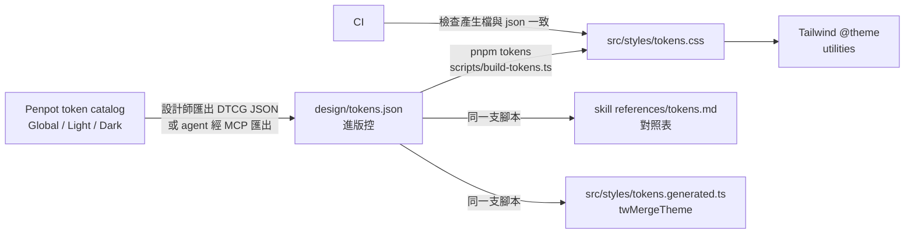
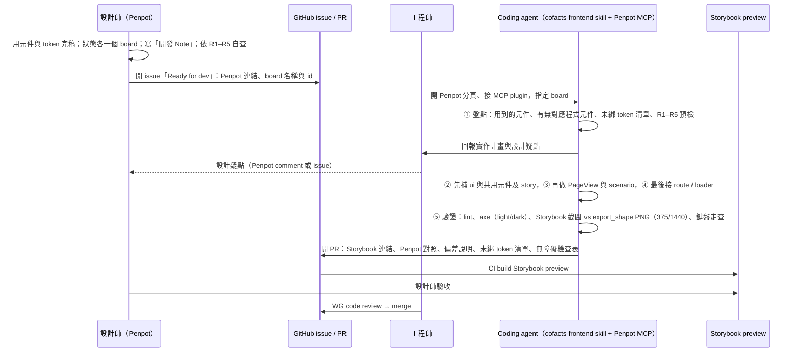

# Cofacts.ai Phase 3：網站遷移與前端架構

> [!NOTE]
> **狀態：討論稿（Draft for discussion）**。給 Cofacts WG、2 位 contractor 工程師與陪伴設計師一起討論用。
> 每節最後的 **❓待討論** 是需要大家拍板的地方；§9 統整所有待決事項。

- 上位規劃：[Cofacts.ai 技術實現路徑報告](../../research/cofacts.ai/Cofacts.ai%20website.md) 的 Phase 3「功能擴充與遷移」
- Phase 2 登入機制：[Authentication](Authentication.md)（已在 [cofacts/ai](https://github.com/cofacts/ai) 實作）
- 設計稿：Penpot 檔案「Cofacts-2026 (26-08-25)」（Penpot MCP 可存取）
- 無障礙指南：設計師提供的「Cofacts 無障礙指南 設計系統 v2（2026.08.27）」，對應 Penpot 檔 Cofacts-2026
- 本文盤點基準：`cofacts/ai@d00e6be`、`cofacts/rumors-site@4d10bbc`、Penpot 檔 `Cofacts-2026 (26-10-08)`、《Cofacts 無障礙與前端實作指南》2026-10-08 版

---

## 0. 摘要

**終局**：`cofacts/ai`（TanStack Start + BFF）完全取代 `cofacts/rumors-site`（Next.js 9 + MUI v4 JSS），部署在 `cofacts.tw`，cofacts.ai 的 AI 查核協作功能移到 `cofacts.tw/ai`。

本文提出：

1. **網址（§2）**：URL 總表依分工 track 分組。rumors-site 既有 path 全部沿用；AI 功能收進 `/ai/*`；列表頁的 search param 改成小寫、可讀、有白名單的新格式，舊格式照收並 redirect 到新格式。語系用 lingui，依 host 切換。
2. **元件（§3）**：分四層，由下而上是 shadcn（Base UI）primitives、Cofacts 領域元件、feature 元件、route。**Penpot 元件路徑 = 程式元件 = Storybook title**，三邊名字一致。
3. **Storybook（§4）**：元件層每個 Penpot variant 一個 story，頁面層每個 Penpot board（含狀態板）一個 scenario。light/dark × 375/1440 全跑 axe。
4. **Penpot ↔ Tailwind（§5）**：規則是「**Penpot token 去掉角色前綴就是 Tailwind class**」，例如 `surface-raised` → `bg-raised`、`text-secondary` → `text-secondary`、`border-control` → `border-control`、`spacing-16` → `p-16`、`RADIUS-5` → `rounded-5`、font size `16` → `text-16`。Tailwind 預設色盤整個關掉，原始色不做成 utility，所以 `text-gray-400`、`text-accent`（品牌黃當字）、`text-15` 這類 class **根本編譯不出來**。已用 Tailwind 4.2.0 實測。
5. **無障礙（§6）**：指南四條規則中，R2（品牌黃不當字）與 R3（只用語意名）靠 token 設計在建構時就擋掉，R1（狀態要有文字）靠元件擋，R4（底色與前景配套）靠 dark 主題的 axe 測試抓。這些規則寫成 `cofacts/ai` 的 repo-level skill `cofacts-frontend`，做前端時自動載入。
6. **分工（§8）**：0（WG 基礎）＋ 1 列表、2 單一訊息與回應、3 回報、4 Infographics、5 AI chat，另加 6 上線切換。§8 談規模與人力建議。**切換前必須讓 Cloudflare 的 HTML cache rule 排除 session cookie**（§2.6）。

---

## 1. 背景與範圍

### 1.1 現況

| | rumors-site（cofacts.tw） | cofacts/ai（cofacts.ai） |
|---|---|---|
| Framework | Next.js 9.5 Pages Router，React 16 | TanStack Start 1.161（React 19，Vite 7，Nitro） |
| 樣式 | MUI v4 `makeStyles`（約 109 檔）/ `withStyles`（約 18 檔），JSS | Tailwind v4（CSS-first，無 config 檔），shadcn `base-maia` style（`@base-ui/react`，非 Radix） |
| 資料 | Apollo Client 2 直連 `api.cofacts.tw/graphql`，colocated fragments | BFF server functions → `cofactsExec`（fetch + GraphQL codegen）；瀏覽器不直連 API |
| 登入 | api.cofacts.tw cookie session | Authorization Code Flow → BFF 的 HttpOnly `cofacts_session` cookie（Phase 2 完成） |
| i18n | ttag + `.po`，build-time 決定 locale（zh_TW / en_US / ja 三個 image；en/ja 只在 staging） | 無，UI 直接寫死繁中 |
| Storybook | v6 + storyshots，build 在 `/storybook` | 尚未合併（[cofacts/ai#126](https://github.com/cofacts/ai/pull/126)：Storybook 10 react-vite） |
| 部署 | GCE + pm2 + cloudflared | Cloud Run 多容器（ingress / ADK backend / cloudsql-proxy），每個 PR 一個 preview revision |

cofacts/ai 目前的前端狀況（Phase 3 要一併處理）：

- `src/styles.css` 的 token 是 shadcn 預設加上手調的 hex（`--primary: #ffb600`、`--foreground: #333333`…），**跟 Penpot 設計系統 v2 沒有對應**。
- 自訂元件大量直接用 Tailwind 原始色盤（`text-gray-400` ×22、`bg-white` ×15、`bg-gray-100` ×12…），dark mode 定義了但沒人用。
- 16 個 shadcn primitives 只有 6 個被 app 用到。icon 同時用 Material Symbols webfont 與 lucide 兩套。
- 無障礙技術債：多個只有 icon 的按鈕沒有 accessible name（漢堡選單、送出、附件…）；backdrop 是有 `onClick` 的 `div`；Material Symbols ligature 沒有 `aria-hidden`。
- 進行中的 PR：[cofacts/ai#138](https://github.com/cofacts/ai/pull/138)（`/report` 回報表單，含 decision record）、[cofacts/ai#139](https://github.com/cofacts/ai/pull/139)（PWA share target）、[cofacts/ai#126](https://github.com/cofacts/ai/pull/126)（Storybook）。

### 1.2 目標

- 新架構完全取代 rumors-site；`cofacts.tw` 是唯一入口，cofacts.ai 的 AI 功能在 `cofacts.tw/ai`。
- 所有頁面依 Penpot 設計系統 v2 重做，同時符合無障礙指南。
- 建立「設計師 Penpot 完稿 → 工程師帶著接了 Penpot MCP 的 coding agent 實作」的可重複流程。

### 1.3 非目標（Phase 3 不做）

- ADK agent 行為調整（`adk/`）。唯一例外是 AI 頁面 URL 搬家可能要改的地方（目前評估不需要）。
- rumors-api schema 的大改動。個別頁面需要的小欄位另開 PR。
- en / ja 的翻譯內容本身。Phase 3 只把 i18n 機制建好、把文案抽成 key（§2.5）。

---

## 2. 網站資訊架構（URL）

### 2.1 原則

1. **既有 path 一律沿用**。外部連結、LINE bot 回覆、搜尋引擎索引都指向這些網址，這批網址不能壞。
2. **path 放「資源」，query 放「檢視狀態」**：path 表示「這是哪一則訊息、哪個人」；篩選、排序、分頁籤放 query。
3. **新網址用英文小寫 kebab-case**；列表用複數（`/articles`），單筆用單數加 id（`/article/:id`），跟既有慣例一致。
4. **query 值要可讀、有白名單**：未知的 param 忽略，不合法的值退回預設，**任何輸入都不能讓頁面 crash**（rumors-site 的 `/search?type=messages` 沒帶 `q`、`/tutorial?tab=xxx` 都會 crash）。
5. **預設值不寫進 URL**，空值不留（rumors-site 會留下 `?filters=&types=`）。
6. **舊網址、舊 param 照收**，再轉到新格式：path 層級用 HTTP 301/308（SSR 做得到）；只有 query 格式不同時，由 route 的 `beforeLoad` 丟出 `redirect({ search, replace: true })`。
7. **不加 locale 前綴**，語系由 host 決定（§2.5）。
8. 預留的頂層 namespace：`/ai`、`/api`、`/report`、`/storybook`（若要自架）。

### 2.2 URL 總表（依分工 track）

圖例：
- 狀態：🟢 沿用；🔵 新增；🟠 沿用 path 但 query 改版；🔴 退場或 redirect。
- **❌ 無稿**：Penpot 沒有這頁的設計。**工程師以 Penpot `Guide` 頁為範例**（它示範了既有頁面怎麼套上新元件與新 token），用新元件自行拼湊，不等新稿。

各 track的規模觀察與人力建議見 §8。

#### Track 0　基礎（WG）：全站共用與系統路由

| URL | 頁面 / 用途 | Penpot | 狀態 | 備註 |
|---|---|---|---|---|
| （全站） | App shell：`Layout/Nav`（Default / login / search / AI 四種）、mobile 選單、`Layout/Footer`、登入 modal、header 搜尋 | ✅ UI system | 🔵 | 各 track都依賴它 |
| （全站） | 語系判定（§2.5） | — | 🔵 | server 依 host 決定 locale |
| `/api/auth/callback?code&state` | OAuth callback（Phase 2） | — | 🟢 | |
| `/api/run-sse` | ADK 串流 proxy | — | 🟢 | |
| 404 / 500 | 錯誤頁（rumors-site 沒有自訂頁） | ❌ 無稿 | 🔵 | |

#### Track 1　列表：列表、篩選與 URL params

| URL | 頁面 | Penpot | 狀態 | 備註 |
|---|---|---|---|---|
| `/articles` | 可疑訊息列表 | ✅ `Doubious Message-1440` / `-Mobile` | 🟠 | param 見 §2.3 |
| `/replies` | 最新查核 | ✅ `Latest replies` / `/ Mobile`、「選單展開示意」「篩選器手機版」 | 🟠 | |
| `/hoax-for-you` | 等你來答 | ❌ 無稿（套 `Doubious Message` 版型） | 🟠 | 只收 `topic` 與時間參數 |
| `/search?q=…&type=messages\|replies` | 搜尋 | ❌ 無稿 | 🟠 | `type` 沿用；沒有 `q` 時顯示空狀態，不 crash |
| `/user/:slug` | 個人頁 | ❌ 無稿 | 🟢 | `tab=replies\|comments`。改用 SSR 301 canonicalize，不用 client `router.replace`（現行會吃掉 `?tab=`） |
| `/user?id=:userId` | 個人頁（沒有 slug 的使用者） | ❌ 無稿 | 🟢 | 使用者有 slug 時 301 到 `/user/:slug`，並保留其他 query |

- 個人頁**不**新增「送過的訊息」tab。使用者送過的訊息改由列表的「我送出的」篩選呈現（`status=reported-by-me`，§2.3）。

#### Track 2　單一訊息與回應

| URL | 頁面 | Penpot | 狀態 | 備註 |
|---|---|---|---|---|
| `/article/:id` | 單一訊息 | ✅ `MessagePage-1440` / `MessagePage-原始訊息`（mobile） | 🟢 + 🔵 hash | 區塊錨點見 §2.4 |
| `/article/:id/reply/new` | 撰寫新回應（全頁編輯器） | ✅ `Message-editor-Write Response…` ×6 | 🔵 | 編輯器裡的 3 個分頁（撰寫回應 / 原始訊息 / 不同意見出處）是表單內狀態，不進 URL |
| `/article/:id/reply/existing` | 使用既有回應 | ✅ `Message-editor-Use Existing Response` ×2 | 🔵 | |
| `/reply/:id` | 單一回應 | ❌ 無稿 | 🟢 | |

#### Track 3　回報可疑訊息（只收網址）

| URL | 頁面 | Penpot | 狀態 | 備註 |
|---|---|---|---|---|
| `/report?url=&text=&title=` | 回報可疑訊息 | ✅ `AI` 頁的「回報可疑訊息流程」6 個狀態板 | 🔵（[cofacts/ai#138](https://github.com/cofacts/ai/pull/138)） | 參數沿用 Web Share Target 的形狀，維持寬鬆解析；[cofacts/ai#139](https://github.com/cofacts/ai/pull/139) 讓 Android 分享選單可直達 |

#### Track 4　Infographics（靜態頁）

| URL | 頁面 | Penpot | 狀態 | 備註 |
|---|---|---|---|---|
| `/` | 首頁（landing） | ❌ 無稿 | 🟢 | 移植現有設計；JSS 改寫成 Tailwind / CSS Modules（§3.6） |
| `/tutorial?tab=bust-hoaxes\|check-rumors` | 使用教學 | ✅ `Guide how-1440` | 🟢 | 不合法的 `tab` 退回預設；修掉站內的錯字連結 `/tutorial?bust-hoaxes` |
| `/about` | Cofacts 是什麼 | ✅ `Guide what-1440` | 🟢 | 設計師註記：「目前僅針對主要樣式套上新的設計系統，原本的教學內容無更動」 |
| `/impact` | 社會影響力報告 | ❌ 無稿 | 🟢 | rumors-site 的版本沒有 header / footer；新版建議納入全站 shell |
| `/terms` | 使用者條款 | ❌ 無稿 | 🟢 | 由 `LEGAL.md` 轉換（build-time 即可） |
| `/instant` | 已退役的 stub | — | 🔴 | 302 到 community builder |

#### Track 5　AI chat

| URL | 頁面 | Penpot | 狀態 | 備註 |
|---|---|---|---|---|
| `/ai` | 新查核任務 | ✅ `AI-open page-1440` / `-Mobile` | 🔵（原 cofacts.ai 的 `/`） | 新增 `?article=:articleId`：從訊息頁的「我要查核闢謠」「引用 AI 查核」帶入文章開新 session |
| `/ai/session/:sessionId` | 查核對話 | ✅ `AI-main page` / `-Mobile` / `-Mobile-Draft` | 🔵 | 預留 `/ai/settings` 等子頁 |
| `/ai/session/:sessionId/tool/:toolCallId` | 對話加右側工具抽屜 | 同上 | 🔵 | 保留「抽屜狀態在 URL 裡」的現行設計 |

#### Track 6　上線切換：redirect、相容與 infra（WG）

| URL | 用途 | 狀態 | 備註 |
|---|---|---|---|
| `cofacts.ai/*` | 舊網域 | 🔴 301 → `cofacts.tw/ai/*` | 在 Cloudflare 處理 |
| `/session/*` | cofacts.ai 舊路徑 | 🔴 301 → `/ai/session/*` | |
| 各列表的舊 query（`filters=`、`types=`…） | 舊 bookmark | 🟠 | `normalizeLegacySearch()` 轉成新格式（§2.3） |
| `/api/articles/:feed?json=…&source=…` | RSS / Atom / JSON feed | 🟢 **原樣保留** | `json` 是 LZMA 壓縮的 GraphQL variables；功能照舊移植，不改版 |
| `en.cofacts.tw`、`ja.cofacts.tw` | 語系 host | 🟢 | 同一個 app 依 host 切語系（§2.5） |
| `/robots.txt`、`/sitemap.xml` | SEO（rumors-site 從來沒有） | 🔵 建議 | |
| `/analytics`、`/hack` | 由 Cloudflare 規則處理 | 🟢 | 沿用 |

### 2.3 列表頁 search param 改版提案

rumors-site 的問題：

- 值是大寫 snake（`NO_REPLY`），時間是 Elasticsearch date math（`now-1w/d`）。
- `types` 和 `articleTypes` 命名不一致；`orderBy` 沒驗證，直接塞進 GraphQL。
- 同名 param 在不同頁意義不同（`start/end` 在 `/articles` 是 `createdAt`，在 `/replies` 是 `repliedAt`）。
- 分頁 cursor 不在 URL。**定案：維持不進 URL**；按上一頁時靠 TanStack Query cache 與 scroll restoration 還原。

URL 不需要跟 Penpot 的 token 名稱綁定，改名只為了**好讀、不容易被誤解**。

#### 查核回應分類（原 `types`）：不互斥、「含有」的語意

Cofacts 的四種分類是**對「一則查核回應」的標記**，不是對訊息真偽的判決：

- 一則訊息可能有多則回應、分屬不同分類。篩「含有錯誤訊息」加「含有正確訊息」是指「有任一則回應屬於其中之一」（any-of），兩者並不互斥。
- 「含有正確訊息」（`NOT_RUMOR`）不等於「這則訊息是真的」，只表示查核者認為其中含有正確資訊。

rumors-site 的問題是 param 名 `types` 看不出是「回應的」分類，值 `NOT_RUMOR` 又容易被人或 AI 望文生義讀成「查證為真」。提案：

| | 提案 |
|---|---|
| param 名 | **`replyType`**：寫明是「回應」的分類 |
| 值 | **沿用 API enum，改小寫 kebab**：`rumor`、`not-rumor`、`opinionated`、`not-article`。與 rumors-api、open data、LINE bot 同一套詞，研究者與 agent 都查得到定義 |
| 防誤解 | ① zod schema 的 `.describe()` 寫明「任一回應被標記為…（any-of，可多選，不代表訊息真偽）」並附中文標籤；② `cofacts-frontend` skill 與 `docs/` 收錄同一段定義；③ UI 標籤一律用「含有錯誤訊息」「含有正確訊息」「含有個人意見」「不在查證範圍」，不用「正確／錯誤」 |

替代方案：值改用標籤語意（`has-misinfo`、`has-facts`、`has-opinion`、`out-of-scope`）。好處是字面就帶出「含有」；壞處是 URL 值與 API enum 不一致，每層都要做對照。目前建議沿用 enum。

#### 完整對照

| 新 param | 舊 param | 值（逗號分隔多選） | 說明 |
|---|---|---|---|
| `status` | `filters` | `asked-once`, `asked-many`, `no-reply`, `replied-many`, `no-useful-reply`, `has-useful-reply`, `replied-by-me`, `not-replied-by-me`, 🔵 `reported-by-me` | 互斥組合在 schema 層處理；`*-by-me` 未登入時忽略，**只忽略它自己**（現行用 `break`，會丟掉之後所有條件）。`reported-by-me` 即「我送出的」，見下方註 |
| `replyType` | `types` | `rumor`, `not-rumor`, `opinionated`, `not-article` | 見上節 |
| `media` | `articleTypes` | `text`, `image`, `video`, `audio` | |
| `topic` | `categoryIds` | 分類 ID | Penpot 篩選器的標題是「主題」 |
| `period` | `start=now-1d/d` 等預設區間 | `1d`, `7d`, `30d` | 「時間不限」即不帶此參數 |
| `from`, `to` | `start`, `end`（自訂區間） | `YYYY-MM-DD` | 每頁在 schema 註明篩的是哪個時間欄位 |
| `sort` | `orderBy` | `last-requested`, `most-requested`, `last-replied`, `my-reply`（個人頁） | 每頁有自己的白名單 |
| `tab` | `tab` | 個人頁 `replies` / `comments`；教學頁 `bust-hoaxes` / `check-rumors` | 沿用 |
| `q`, `type` | `q`, `type` | `/search` | 沿用 |

> [!NOTE]
> **「我送出的」需要確認 API 語意**：rumors-api 的 `ListArticleFilter.selfOnly` 只會列出「由目前使用者**建立**」的訊息（第一個回報者）。沒有「我曾回報過（含對既有訊息 +1）」的 filter（2026-09-28 查 `api.cofacts.tw` schema）。若「我送出的」要包含 +1 過的訊息，需要在 rumors-api 補一個依 reply request 的 `userId` 篩選的 filter。

- 實作方式：每個列表 route 用 `validateSearch` + zod schema，放在 `src/lib/search-params/`。同一份 schema 產生三樣東西：GraphQL filter、篩選 UI 的狀態、canonical URL。
- 舊 param 由 `normalizeLegacySearch()` 轉換（`filters=NO_REPLY` → `status=no-reply`、`types=NOT_RUMOR` → `replyType=not-rumor`、`start=now-1w/d` → `period=7d`…），轉完用 `replace` redirect。

範例：

```
舊 /articles?filters=NO_REPLY,ASKED_MANY_TIMES&types=RUMOR&start=now-1w/d&orderBy=replyRequestCount
新 /articles?status=no-reply,asked-many&replyType=rumor&period=7d&sort=most-requested
```


### 2.4 訊息頁的區塊錨點

設計師註記：「手機版為橫式選單，可左右滑動。互動如桌機，點擊前往該區塊」（`Layout/ActionPanel`「快速索引」）。提案的 hash：

| hash | 區塊 |
|---|---|
| `#replies` | 查核回應 (n) |
| `#reply-:replyId` | 單一則查核回應（🔵 新增，rumors-site 沒有單則回應的深連結） |
| `#ai-analysis` | AI 自動分析（「若無查核回應就會顯示 AI 自動分析」） |
| `#similar` | 相似可疑訊息與組合 |
| `#original` | 原始訊息 |

### 2.5 語系（i18n）

- **採用 `@lingui/react`**：以英文原文作為翻譯 key，抽出成 gettext `.po` 檔（沿用 rumors-site 的翻譯流程與既有 `.po`）。runtime 載入編譯後的 message catalog 切換語系，不必像 ttag 那樣每個語系 build 一個 image。
- **語系由 host 決定**，沿用現有的三個 host。URL 不加 locale 前綴，既有網址不變。

  | host | locale |
  |---|---|
  | `cofacts.tw` | `zh-TW`（預設） |
  | `en.cofacts.tw` | `en` |
  | `ja.cofacts.tw` | `ja` |

  - root route 的 `beforeLoad` 呼叫 server function，讀 `Host` header（Cloudflare 之後讀 `X-Forwarded-Host`）決定 locale，SSR 時就載入對應 catalog，並輸出 `<html lang>`。
  - 各語系頁面互相輸出 `hreflang` alternate link。
  - 使用者手動切換語系時，導到對應 host 並保留 path 與 query。
  - 不同 host 的 CDN cache key 本來就分開，不會混到語系。
- **只翻 UI 文案**：訊息、回應等使用者內容維持原文。
- 影響工作量的地方：
  - cofacts/ai 現有的繁中寫死文案要改寫成英文 key（Track 0處理 shell 與 ui 元件；其他 track各自處理）。
  - `cofacts-frontend` skill 規定所有 UI 字串都要經過 `t` / `<Trans>`。
  - 日期格式一律依當前 locale，不能寫死 `zh-TW`。

### 2.6 切換策略（Strangler Fig）

1. **並存期**：新 app 部署在 Cloud Run，Cloudflare 依 path 把「已遷移的路徑」導到新 app，其餘仍到 GCE 上的 rumors-site。可以一頁一頁切。
2. **登入並存**：舊站用 api.cofacts.tw 的 session，新站用 BFF cookie。使用者在舊站已登入時，新站的 login redirect 到 api 會直接回來，體感是一鍵登入。**兩邊的登出不會同步**，這點要接受或另外處理。
3. **Cloudflare cache（⚠️ 必做）**：
   - 現況：依 `cofacts/devops` 的 `Cloudflare.md`「Cache Rules (As of 2026-06-11)」，SSR HTML 有 **60s Edge TTL override**。範圍是 `cofacts.tw` 的 `/`、`/articles`、`/search`、`/replies`，以及 en/ja/zh 全站規則；只排除 `/_next/`、含 `.` 的路徑、`/user`，以及帶 `isUserBlocked=1` cookie 的請求。
   - 風險：override 模式會**忽略 origin 的 `Cache-Control`**。新站在 SSR 直接渲染登入後畫面（§3.5）後，A 使用者的登入畫面可能在 60 秒內被快取並回給其他人。
   - 切換前要做：
     - ① 所有 cache rule 加上排除 `cofacts_session` cookie 的條件（與現行排除 `isUserBlocked=1` 同理）；
     - ② 新 app 對帶 session 的回應一律送 `Cache-Control: private, no-store`，作為第二道防線；
     - ③ 規則裡 rumors-site 專屬的排除條件（`/_next/`）改成新 app 對應的路徑（Vite 產生的 asset 路徑）。
4. **全面切換**：`cofacts.tw/*` 全部導到新 app，`cofacts.ai/*` 301 到 `cofacts.tw/ai/*`，rumors-site 退場。

> [!NOTE]
> 本文件即為上述決策（AI 搬到 `/ai`、routing 整合、token 命名規則）的設計紀錄。cofacts/ai 的 `docs/` 直接超連結到本文即可；只有實作過程中出現本文未涵蓋的取捨時，才另外寫 ADR。

---


## 3. 元件架構

### 3.1 技術原則

- **Tailwind v4 為主**；只有 Tailwind 表達不好的時候才用 **CSS Modules**（`Foo.module.css`）：複雜 keyframes、`::before` 裝飾、捲動動畫、第三方 DOM（ProseMirror）。**禁止任何 CSS-in-JS**。
- **shadcn（`base-maia` style，建在 `@base-ui/react` 上）** 作為 primitives。shadcn 的程式碼是 repo 自己擁有的，我們直接改成 Cofacts token（§5.4），不保留 shadcn 那層語意變數（`--primary`、`--muted`…）。
- **變體**用 `class-variance-authority`（cva）。shadcn 官方元件本來就用 cva（cofacts/ai 的 `ui/button.tsx` 等即 CLI 產生），保留它以便和 upstream 對照；Penpot 的具名 variant 屬性也能一對一對應到 cva 的 `variants`。cva 在 runtime 只做查表與字串串接，CSS 仍由 Tailwind 在建構時掃描產生。
- **合併 class 用 `cn()`（clsx + tailwind-merge），但必須用 `extendTailwindMerge` 設定 Cofacts 的自訂 class**。tailwind-merge 不讀 `@theme`，預設把不認得的 `text-*` 都當成文字色。實測 `tailwind-merge@3.4.1`：
  | `cn(...)` | 未設定 | 設定後 |
  |---|---|---|
  | `text-body-m` + `text-primary` | `text-primary`（字體被吃掉） | 兩個都保留 |
  | `text-heading-xl` + `text-heading-m` | `text-heading-m` | `text-heading-m` |
  | `rounded-5` + `rounded-full` | 兩個都保留 | `rounded-full` |
  | `shadow-btn` + `shadow-none` | 兩個都保留 | `shadow-none` |

  ```ts
  // src/lib/utils.ts
  import { clsx, type ClassValue } from 'clsx'
  import { extendTailwindMerge } from 'tailwind-merge'
  import { twMergeTheme } from '@/styles/tokens.generated' // 由 token 腳本產生（§5.4）

  const twMerge = extendTailwindMerge({ extend: { theme: twMergeTheme } })
  export const cn = (...inputs: ClassValue[]) => twMerge(clsx(inputs))
  ```

  `twMergeTheme` 由 token 腳本和 `tokens.css` 一起產生（`text` 放 17 個字體名、`radius`、`shadow`、`color` 放語意色名），不手寫。`cn()` 另加單元測試涵蓋上表，防止升級或 token 變動時默默壞掉。
- **Icon 統一一套**：Penpot 的 `Base/Icon` 的 `Name` 屬性值就是 Material Symbols 名稱（`Open-In-New`、`Thumb Up`、`Format List Bulleted`…），另外有 Cofacts 自訂的 status 與品牌 icon（`line`、`fb`…）。四種查核狀態的 icon 是四種形狀（八角叉、圓勾、方三點、三角驚嘆號），讓色弱使用者不靠顏色也能分辨（指南 03）。
  - 建議做一個 `<Icon name>` 元件，改成 **SVG import**（例如 `@material-symbols/svg-400` 按需引入），取代 webfont ligature。webfont 會被螢幕閱讀器念出 ligature 文字，也會有 FOUT。
  - shadcn primitives 裡的 lucide 也一併換掉。
- **元件不碰資料取得**：共用元件與 `-components/` 只吃 typed props（元件用一般 TypeScript 宣告自己需要的欄位，不用 GraphQL fragment），資料由 route component 透過 TanStack Query 取得，寫入則以 callback props（`onSubmit`、`onLoadMore`）傳給元件（§3.5「取資料」）。這樣 Storybook 不需要 mock 網路或 server function，fixture 餵 props、callback 用 `fn()` 就能跑（§4）。
- **一個響應式元件取代 Penpot 的 desktop / mobile 兩個元件**：Penpot 有 `FactCheckCard` 與 `FactCheckCard-Original-Mobile`、`Footer` 與 `Footer-Mobile` 這類成對元件，程式裡合成一個，用斷點切換。

### 3.2 分層

元件只分三層，加上產生的 token 檔：

| 層 | 目錄 | 內容 | 誰維護 |
|---|---|---|---|
| tokens | `src/styles/tokens.css`（產生檔） | Penpot token 轉成的 CSS 變數與 `@theme` | 腳本產生，不手改 |
| ui | `src/components/ui/` | shadcn / Base UI primitives：Button、Input、Select、Checkbox、Switch、Toggle、Dialog、Popover、Menu、Tabs… | WG（Track 0） |
| 共用元件 | `src/components/`（平鋪） | 兩處以上用到的元件：用 ui 組出來的複合元件（`ReplyTypeLabel`、`FactCheckReply`、`ArticleCard`…），以及重複出現的大元件（`SiteNav`、`SiteFooter`） | 首次用到的 track 負責，其他 track共用（§8.3） |
| 頁面 | `src/routes/` | route component（loader、`validateSearch`、`head()`、組版面），以及只有該頁用的元件，放在同目錄的 `-components/` | 各 track |

**頁面專用元件放 `-components/`**：

- TanStack Router 會忽略 `-` 開頭的檔案與資料夾，不產生 route，這是官方建議的 colocation 做法（[Routing Concepts › Excluding Files and Folders from Routes](https://tanstack.com/router/latest/docs/framework/react/routing/routing-concepts)）。
- 頁面專用元件一律放進 `-components/`，不放成 `-Foo.tsx` 散檔。這樣 `routes/` 底下 `-components/` 以外的檔案都是 route，目錄一眼看得懂。
- `-components/` 的範圍是它所在的目錄：`routes/article.$id/-components/` 給 `/article/:id` 底下的 route（訊息頁、兩個編輯器頁）共用。
- **不跨目錄 import 別人的 `-components/`**。第二個地方要用時，把元件搬到 `src/components/`，並補上 story 與 Penpot 對照。不必事先判斷元件「該放哪一層」。
- 以上規則要寫進 `cofacts-frontend` skill（§6.3），agent 才會照做，lint 也要擋跨目錄 import。

### 3.3 Penpot 元件 → 程式元件對照

Penpot 本地元件庫共 **48 個元件**（依 2026-10-08 的 `Cofacts-2026 (26-10-08)`）。variant 屬性已全部改成具名屬性：`Type`、`State`、`Device`、`Selected`、`Name`，Button 拆成 `Size` / `Style` / `Icon` 三個屬性。**variant 屬性直接對應 cva 的 prop**，值轉成 kebab-case（`Icon-Touch` → `icon-touch`、`OnDark` → `on-dark`）；`Device: Desktop / Mobile` 與 `-Mobile` 後綴的元件合成一個響應式元件，不變成 prop。

2026-10-08 版刪除的元件：`Base/FieldDescription`（`ui/field` 自行實作 description）、`Base/Flag-Mobile`（手機共用 `Base/Flag`）、`Layout/ExitEditor`（編輯器改用底部「取消編輯」按鈕，不做 EditorExitBar）、`Feedback/VoteCounter`、`Content/ReplyEditor-Tabs`（由 `Content/EditorTab` 取代）。

| Penpot 元件 | Penpot variants（現況） | 程式元件 | 層 | 主要使用頁 |
|---|---|---|---|---|
| `Base/Button` | `Size`：Large 44 / Medium 36 / Small 28 / Icon-Touch 32；`Style`：Primary / Outline / Secondary / LINE / OnDark；`Icon`：None / Front / Back / Both / Only | `ui/button`：`size: lg\|md\|sm\|icon-touch`、`variant: primary\|outline\|secondary\|line\|on-dark`、`icon: none\|start\|end\|both\|only`（`only` 必填 `aria-label`） | ui | 全站 |
| `Button AI` | `State`：default / hover / loading / icon / Secondary / disable | `AiButton`（loading 加 `aria-busy`；黃色漸層框前端用 `brand-500-main` → `brand-300` 重做） | 共用 | 訊息頁、AI |
| `Base/Input` | `Type`：15 個（Basic / Field / Textarea / icon × default / active / disable / Invalid、icon-hover、AI、AI-loading） | `ui/input`、`ui/textarea`、`ui/input-group`、`ui/field`；AI 版是 `/ai` 的 `-components/ChatInput`（AI-loading 的提示放 `role="status"`） | ui / 頁面 | 表單、搜尋、AI |
| `Base/Select` | `State`：default / open / small | `ui/select`（原生 `<select>` 優先） | ui | 篩選、排序 |
| `Base/Checkbox`、`Base/RadioGroup`、`Base/Switch` | Checkbox `State`：default / checked / disable / Description；RadioGroup `Type`：default / disable / Description；Switch `State`：off / on / disable | `ui/checkbox`、`ui/radio-group`、`ui/switch` | ui | 篩選、編輯器 |
| `Base/Toggle` | `State`：default / hover / active / outline / outline-hover / outline-active | `ui/toggle`（`aria-pressed`，收藏） | ui | 訊息頁 |
| `Base/Badge` | `Type`：icon-default / icon-active / normal / normal-active / disable / fix（例：「還未有效查核」） | 篩選標籤：`ui/toggle-group`（`<button aria-pressed>`，`normal-active` = 已選取）；純顯示：`ui/badge` → `ArticleStatusBadge` | ui / 共用 | 列表 |
| `Base/Flag` | —（例：「從零開始的魔法旋轉花花 \| Lv. 11」；手機共用） | `UserFlag`（作者名 + 等級；橘色摺角 `surface-accent-fold`，純裝飾） | 共用 | 回應、留言 |
| `Base/Avatar` | `Type`：default / no-level / Certification / Certification-level | `UserAvatar`（整併現有 `UserAvatar` + `OpenPeepsAvatar`；Certification 對應 [Badge System](../badge-system.md)） | 共用 | 全站 |
| `Base/Icon` | `Name`：41 個 icon | `ui/icon`（`aria-hidden`） | ui | 全站 |
| `Layout/Nav` | `Type`：Default / login / search（另有 `AI`，但沒有任何畫面使用，不實作） | `SiteNav`（AI 頁也用同一個，目前頁為「問問 AI」） | 共用 | 全站（含 AI） |
| `Layout/NavItem` | `State`：hover / default / alert / mobile / mobile-active / mobile-alert | `NavItem`（目前所在頁 = `hover` 的底線樣式，加 `aria-current="page"`；alert = 「等你來答」未解數，例如 99+，要讓螢幕閱讀器唸出） | 共用 | 全站 |
| `Layout/Nav-Mobile`、`Nav-MobileExpanded` | Nav-Mobile `State`：open / default / second-menu / search；Nav-MobileExpanded 只剩 open-full | 合進 `SiteNav` 的 mobile 狀態（漢堡／關閉鈕用 Button `Icon-Touch`，`aria-expanded` + `aria-controls`，Esc 關閉並還焦點） | 共用 | 全站 |
| `Layout/Footer`、`Footer-Mobile` | — | `SiteFooter`（**底色 `surface-dark`，前景只能用 `-on-dark`**，見 R4 案例；頂部 1px `border-on-dark`） | 共用 | 全站 |
| `Layout/Logo` | `Type`：symbol / horizontal / AI / icon | `Logo` | 共用 | 全站 |
| `Layout/ActionPanel` | `Device`：Desktop / Mobile | `-components/ArticleQuickNav`（桌機 `<nav aria-label="本頁索引">` + 錨點；手機分頁列可橫向捲動，「查核闢謠」是浮動按鈕） | 頁面 | 訊息頁 |
| `Content/FactCheckCard`、`FactCheckCard-Original-Mobile` | — | `ArticleCard`（列表中的一則訊息 + 回應摘要） | 共用 | `/replies`、`/articles`、首頁 |
| `Content/FactCheckReply`、`ReplyCard-Mobile` | `Type`：default / with-link | `FactCheckReply`（回應本文 + 出處 + 作者 + 回饋） | 共用 | 列表、訊息頁、回應頁 |
| `Content/FactCheckReply-Title` | `Type`：Incorrect / Correct / PersonalOpinion / NotVerifiable（含 -mobile） | `ReplyTypeLabel`（**R1 的主要實作點**，§6） | 共用 | 全站 |
| `Content/AIFactCheckCard` | `Type`：4 種判定，各有 -active | `-components/VerdictPicker`（AI 草稿選分類） | 頁面 | AI |
| `Content/AIMessageCard` | default / hover / active / active-hover | `-components/SessionListItem` | 頁面 | AI 側欄 |
| `Content/AIAnalysisPanel` | — | `-components/AiAnalysisPanel` | 頁面 | 訊息頁 |
| `Content/DisputedMessage`、`-Mobile` | default / read | `ArticleListItem`（可疑訊息列表的一則） | 共用 | `/articles`、`/hoax-for-you`、搜尋 |
| `Content/MessageListItem` | — | `ReplyRequestItem`（網友回報補充） | 共用 | 訊息頁、個人頁留言 tab |
| `Content/LinkCard` | — | `HyperlinkPreview` | 共用 | 訊息頁、回應 |
| `Content/Transcript` | — | `-components/Transcript`（協作逐字稿，見 §8 Track 2的風險） | 頁面 | 訊息頁 |
| `Content/FactCheckResultCard` | ExistingResponses / -mobile | `-components/ExistingReplyCard`（「直接用此回應」）；回報流程 B-1 也會用到 | 共用 | 編輯器、`/report` |
| `Content/EditorTab`、`EditorTab-Mobile` | `Selected`：撰寫新回應 / 使用既有回應 | `-components/EditorTabs`（基於 `ui/tabs`：`tablist` / `tab` / `tabpanel`，左右鍵切換）；兩個分頁對應 `/reply/new`、`/reply/existing` | 頁面 | 編輯器 |
| `Content/OriginalMessage`、`-Mobile` | `State`：Collapsed / Expanded | `-components/OriginalMessage`（`<button aria-expanded>`；手機展開限高約 240px、內部捲動、`overscroll-behavior: contain`、`tabindex=0`；編輯器取得焦點時自動收合；底部漸層用 `surface-base` → 透明重做） | 頁面 | 編輯器 |
| `Content/AIWelcome`、`-Mobile` | — | `-components/Welcome` | 頁面 | `/ai` |
| `Content/ReportPrompt` | — | `-components/ReportPrompt`（回報可疑訊息的空狀態提示） | 頁面 | `/report`、搜尋無結果 |
| `Content/QACard`、`QACard-Answer` | — | `-components/QaCard` | 頁面 | 教學 |
| `Feedback/ReactionGroup` | `Type`：reason（看理由）/ report（檢舉） | `ReplyFeedback`（有幫助 / 沒幫助 + 理由、檢舉） | 共用 | 回應 |
| `Feedback/ReportStatus` | `Device`：Desktop / Mobile（回應 0 · 回報 23） | `ArticleStats` | 共用 | 列表 |
| `Feedback/Category` | —（# 分類 · 分類建議） | `ArticleCategories` | 共用 | 訊息頁 |
| `Feedback/ViewChart`、`Chart-Mobile` | — | `-components/ViewChart`（近 30 日瀏覽；線色用 `--chart-1` / `--chart-2`；圖表 `aria-hidden`，另給文字摘要，圖例寫明文字） | 頁面 | 訊息頁 |

各頁實際用到的元件（由 Penpot 實例統計）：

| 頁面 board | 用到的元件 |
|---|---|
| `Latest replies` | Nav, NavItem, Footer, Select, Toggle, Badge, Button, Avatar, FactCheckCard, FactCheckReply, FactCheckReply-Title, ReactionGroup |
| `Doubious Message-1440` | Nav, Footer, Select, Badge, Button, DisputedMessage, ReportStatus |
| `MessagePage-1440` | Nav, Footer, ActionPanel, Flag, Avatar, Button, Toggle, Input, Select, Badge, Category, ViewChart, LinkCard, Transcript, MessageListItem, FactCheckReply, FactCheckReply-Title, ReactionGroup, AIAnalysisPanel |
| `AI-main page` | Nav, Footer, Select, Button, Button AI, Input, AIMessageCard, AIFactCheckCard |
| `Guide how-1440` | Nav, Footer, Flag, QACard, QACard-Answer, Button |

### 3.4 前端目錄結構提案

```
src/
├── routes/                          # 頁面層：-components/ 以外都是 route
│   ├── __root.tsx                   # 全站 shell：GlobalNav + <Outlet> + GlobalFooter（各 route 可用 staticData 關掉）
│   ├── index.tsx                    # /
│   ├── (lists)/                     # route group：不影響 URL，只為了讓列表頁共用 -components/
│   │   ├── -components/             # /articles、/replies、/hoax-for-you、/search 共用：FilterPanel、SortSelect、LoadMore
│   │   ├── articles.tsx             # /articles
│   │   ├── replies.tsx  hoax-for-you.tsx  search.tsx
│   ├── article.$id/
│   │   ├── index.tsx                # /article/:id（route component + 本頁的 createServerFn）
│   │   ├── reply.new.tsx            # /article/:id/reply/new
│   │   ├── reply.existing.tsx
│   │   └── -components/             # 訊息頁與編輯器專用：Transcript、ArticleQuickNav、EditorTabs、OriginalMessage…
│   ├── reply.$id.tsx
│   ├── user.tsx                     # /user?id=
│   ├── user.$slug.tsx
│   ├── tutorial.tsx  about.tsx  impact.tsx  terms.tsx
│   ├── report.tsx                   # /report（#138 移入）
│   ├── ai/
│   │   ├── index.tsx                # /ai（有 footer）
│   │   ├── session.$sessionId.tsx   # 有 side panel：staticData.hideGlobalFooter
│   │   ├── session.$sessionId.tool.$toolCallId.tsx
│   │   └── -components/             # 現有 ChatArea、AgentMessage、RightDrawer（拆檔）、VerdictPicker、SessionSidebar…
│   ├── session.$.tsx                # 舊 cofacts.ai 網址 → 301 /ai/session/*
│   ├── api/
│   │   ├── run-sse.ts  auth/callback.ts
│   │   └── articles.$feed.ts        # RSS 相容
│   ├── robots[.]txt.ts  sitemap[.]xml.ts
├── components/
│   ├── ui/                          # shadcn/Base UI（已改寫成 Cofacts token）
│   └── *.tsx                        # 共用元件，平鋪：SiteNav、SiteFooter、ReplyTypeLabel、FactCheckReply、ArticleCard…
├── server/                          # BFF 共用
│   ├── cofacts.server.ts            # cofactsExec、rumors-api secret（唯一讀 secret 的地方）
│   ├── jwt.server.ts  api-base.server.ts …  # 既有 server-only utility 一律改名 *.server.ts
│   ├── gql/                         # codegen 產物
│   └── <domain>/                    # 多個 route 共用的 server function，例如 article.functions.ts
├── lib/
│   └── search-params/               # 列表 search param 的 zod schema（route 與元件共用）
├── hooks/
├── fixtures/                        # Storybook 與測試共用的 typed 假資料
└── styles/
    ├── global.css                   # 入口：@import tailwindcss、tokens，加上全站規則（焦點環等）
    ├── tokens.css                   # ⚙️ 由 design/tokens.json 產生
    └── tokens.generated.ts          # ⚙️ 同上：給 cn() 的 twMergeTheme
design/
└── tokens.json                      # Penpot 匯出的 token（DTCG JSON），token 的來源
```

**全站 shell 放在 `__root.tsx`，各 route 用 `staticData` 關掉不要的部分。** Penpot 裡所有頁面（含 AI 首頁）共用同一組 Nav 與 Footer，只有進入有 side panel 的畫面（AI 對話、編輯器）時不放 footer。所以不另設 `_site` 這類 pathless layout，route 直接放在 `routes/` 下：

```tsx
// src/routes/__root.tsx（節錄）
declare module '@tanstack/react-router' {
  interface StaticDataRouteOption {
    /** 這個 route 自己畫 nav（或不要 nav）時設 true */
    hideGlobalNav?: boolean
    /** 有 side panel 等不適合放 footer 的畫面設 true；畫面會改成滿版高度 */
    hideGlobalFooter?: boolean
  }
}

function RootLayout() {
  const { hideGlobalNav, hideGlobalFooter } = useMatches({
    select: (matches) => ({
      hideGlobalNav: matches.some((m) => m.staticData.hideGlobalNav),
      hideGlobalFooter: matches.some((m) => m.staticData.hideGlobalFooter),
    }),
  })
  return (
    <div className="flex min-h-dvh flex-col">
      {!hideGlobalNav && <GlobalNav />}
      <Outlet />
      {!hideGlobalFooter && <GlobalFooter />}
    </div>
  )
}

// src/routes/ai/session.$sessionId.tsx
export const Route = createFileRoute('/ai/session/$sessionId')({
  staticData: { hideGlobalFooter: true },
  …
})
```

- 任一層 route 設了旗標就生效，所以設在父 route（例如 `ai/session.$sessionId`）會連子 route 一起套用。
- 要自訂 nav 或 footer 的頁面，設 `hideGlobalNav` / `hideGlobalFooter` 後自己畫。
- 只服務某一區的 UI（例如 AI 的對話列表側欄）放在該區的 route 或 `-components/`，不放進 root。

靜態頁（首頁、`/impact`、教學）的 `*.module.css` 與圖片也放各自的 `-components/`（或 `-assets/`）。

每個元件的檔案 colocate：`Foo.tsx`、`Foo.stories.tsx`、`Foo.module.css`（需要時）、`Foo.test.tsx`（有邏輯時）。

### 3.5 資料層：server to server

前端不寫 GraphQL、不直接連 rumors-api。之後 rumors-api 會用 secret（Cloudflare token）保護，只接受 server to server 的請求；資料一律經 TanStack Start 的 server function 送到 UI。

| 放什麼 | 放哪裡 | 誰可以 import |
|---|---|---|
| server-only utility：`cofactsExec`、secret、JWT 處理 | `*.server.ts`（`src/server/cofacts.server.ts` 等） | 只在 server function 的 handler 裡用 |
| GraphQL document | **inline 在 server function 的 handler 裡**（`graphql()`），跟著 server function 走，不單獨抽檔 | 只在 handler 裡用 |
| server function（`createServerFn`） | **預設 inline 在 route 檔裡**，寫在 module 最上層 | 任何地方 |
| 型別、zod schema、常數 | 一般 `.ts` | 任何地方 |

規則：

1. **單一 route 的 server function 直接寫在 route 檔裡**。Start compiler 不看檔名，會把每個 `createServerFn(...).handler(...)` 在 client build 換成 RPC stub，並移除只有 handler 用到的 `*.server` import。
2. **route 檔太長，或多個 route 共用時，再把整個 server function 連同它的 `queryOptions` factory 抽出來**（query 跟著走，不單獨抽；見「取資料」第 5 點）。抽到哪裡看情況，可以和相關的一般 util 放一起；**整個檔案都是 server function 時，命名為 `*.functions.ts`**（TanStack 文件建議的慣例）。`*.functions.ts` 不能命名成 `*.server.ts`，否則 client 無法 import。
3. **loader 只能呼叫 server function**。TanStack Start 的 loader 是 isomorphic：SSR 時在 server 跑，client 端換頁時在瀏覽器跑。直接在 loader 呼叫 rumors-api 會把請求和 secret 帶到瀏覽器。
4. **`*.server` 的 import 只能在 handler 裡用**。handler 以外（例如同檔案的 helper）用到，import 就會留在 client bundle；Start 的 import protection 在 dev 只警告並換成 mock，**production build 才會失敗**。所以 CI 必須跑 build（§7），agent 在 dev 看到 import protection 警告要當成錯誤立刻修。
5. secret 只能在 `cofacts.server.ts` 讀。import protection 只保護 `*.server.*` 檔（或有 `import '@tanstack/react-start/server-only'` 的檔），寫死在一般檔案的字串或在一般檔案讀 `process.env` 都擋不到。
6. 共用元件與 `-components/` 不碰資料取得，只吃 typed props；query hook 只在 route component 呼叫（見下方「取資料」）。**不用 GraphQL fragment 描述元件需要的欄位**（rumors-site 的 colocated fragments 不延續）：元件用一般 TypeScript 型別宣告 props，route 把 query 結果傳進去，形狀對不上時由 `tsc` 擋下。需要沿用 query 的型別時，從 codegen 產生的 query result type 取子型別即可。

參考：TanStack Start 文件 [Execution Model](https://tanstack.com/start/latest/docs/framework/react/guide/execution-model)、[Server Functions › File Organization](https://tanstack.com/start/latest/docs/framework/react/guide/server-functions)、[Import Protection](https://tanstack.com/start/latest/docs/framework/react/guide/import-protection)。

#### 取資料：TanStack Query

1. **資料原則上都進 TanStack Query cache**。SSR 期間累積的 query cache 由 `setupRouterSsrQueryIntegration` serialize 到前端，瀏覽器 hydrate 後直接使用，不重打 server function。每個 request 各自建立 `QueryClient`（cofacts/ai 的 `getRouter()` 已如此），避免使用者之間的 cache 混用。
2. **SSR 就要有的資料，用 `useSuspenseQuery`**；只需在 client 取得的（例如 AI session 列表、「我是否已回饋」），用 `useQuery`。`useEffect` 與一般 `useQuery` 都不會在 SSR 執行，資料不會出現在 HTML 裡。
3. **只有 `head()` 需要資料，或要決定頁面是否存在（`notFound()`、`redirect()`）時，才寫 route loader**。loader 裡用 `await context.queryClient.ensureQueryData(...)` 填 cache，**只回傳 `head()` 需要的欄位**：loader 的回傳值也會 serialize 到前端，回傳整份資料會和 query cache 重複。頁面內容一律從 query cache 讀，不用 `useLoaderData()`。在 loader 裡決定 404，SSR 的 HTTP 狀態碼才會正確；元件 streaming 開始後才丟錯，狀態碼已經送出。
4. **寫入**用 `useMutation` 呼叫 server function，成功後 `invalidateQueries` 對應的 query key。
5. **queryKey = `[GraphQL operation name, variables]`**，例如 `['GetArticle', id]`；多個參數的（列表的篩選條件）再用物件，例如 `['ListArticles', filter]`。每個 route 各自定義 `queryOptions`，若用 `['article', id]` 這類自訂 key，兩個 route 選了不同欄位卻用同一個 key 就會互相覆蓋 cache；codegen 要求 operation name 全專案唯一，用它當 key 就不會撞。key 與 `queryFn` 一律寫在同一個 `queryOptions` 裡（TkDodo〈The Query Options API〉、Start 官方指南的做法）。
   **`articleQuery(id)` 這種 `queryOptions` factory 是共用資料取得的首選封裝**：它把彼此直接相關的 queryKey 與 queryFn 包在一起，同一個呼叫既能給 loader 的 `ensureQueryData` 用，也能給元件的 `useSuspenseQuery` / `useQuery` 用。資料要跨 route 共用時，優先把 server function 連同它的 `queryOptions` factory 一起抽出、export，而不是只 export server function 再讓各處自己拼 key。和使用者有關的 query（例如 `GetMyFeedback`）在登出或切換帳號時要從 cache 移除。
6. **`staleTime` 依 query 設定**。cofacts/ai 現在全域是 `Infinity`，適合 AI 對話，但列表頁回來時會看到舊資料。至少要大於 0，否則瀏覽器拿到 SSR 資料後會立刻重打一次。
7. （選用）巢狀很深的 `useSuspenseQuery` 想提早開始，可以在 loader 呼叫 `ensureQueryData` 但不 `await`，避免 waterfall，也不擋 SSR。

```tsx
// src/routes/article.$id/index.tsx
import { createFileRoute, notFound } from '@tanstack/react-router'
import { createServerFn } from '@tanstack/react-start'
import { queryOptions, useSuspenseQuery, useQuery } from '@tanstack/react-query'
import { z } from 'zod'
import { cofactsExec } from '@/server/cofacts.server'
import { graphql } from '@/server/gql'
import { ArticlePageView } from './-components/ArticlePageView'

const getArticle = createServerFn({ method: 'GET' })
  .inputValidator(z.string())
  .handler(({ data: id }) =>
    cofactsExec(
      graphql(`
        query GetArticle($id: String!) {
          GetArticle(id: $id) {
            id
            text
            attachmentUrl(variant: THUMBNAIL)
            createdAt
            articleReplies(status: NORMAL) {
              reply { id type text reference }
              positiveFeedbackCount
              negativeFeedbackCount
            }
          }
        }
      `),
      { id },
    ),
  )

// 示範 client side query 用。實際上「我的回饋」可以直接併入上方的 GetArticle operation，
// 和文章一起在 SSR 載入（SSR 本來就是登入後畫面，見下方「其他」）。
const getMyFeedback = createServerFn({ method: 'GET' })
  .inputValidator(z.string())
  .handler(({ data: id }) =>
    cofactsExec(
      graphql(`
        query GetMyFeedback($id: String!) {
          GetArticle(id: $id) {
            articleReplies(status: NORMAL) {
              replyId
              ownArticleReplyFeedback { score }
            }
          }
        }
      `),
      { id },
    ),
  )

const articleQuery = (id: string) =>
  queryOptions({ queryKey: ['GetArticle', id], queryFn: () => getArticle({ data: id }), staleTime: 60_000 })

export const Route = createFileRoute('/article/$id/')({
  // head() 要標題、要決定 404，所以寫 loader；只回傳 head 需要的欄位
  loader: async ({ context, params }) => {
    const { GetArticle: article } = await context.queryClient.ensureQueryData(articleQuery(params.id))
    if (!article) throw notFound()
    return { title: article.text.slice(0, 60), image: article.attachmentUrl }
  },
  head: ({ loaderData }) => ({
    meta: [
      { title: `${loaderData.title} | Cofacts` },
      { property: 'og:image', content: loaderData.image },
    ],
  }),
  component: ArticlePage,
})

function ArticlePage() {
  const { id } = Route.useParams()
  const { data } = useSuspenseQuery(articleQuery(id))            // SSR：從 cache 讀，loader 已填好
  const { data: feedback } = useQuery({                          // 示範 client 端取得；見 getMyFeedback 上方註解
    queryKey: ['GetMyFeedback', id],
    queryFn: () => getMyFeedback({ data: id }),
  })
  return <ArticlePageView article={data.GetArticle!} myFeedback={feedback} />
}
```

`graphql()` 寫在 handler 裡：GraphQL 形狀、server function 與使用它的 component 在同一個檔案，codegen 從這裡產生型別，一路推導到 `useSuspenseQuery` 的 `data`；client build 時整個 handler 連同 query 字串一起被換成 RPC stub。

Track 0（WG 基礎，§2.2、§8）要完成的設定：`createRouter({ context: { queryClient } })`、root route 改用 `createRootRouteWithContext<{ queryClient: QueryClient }>()`（官方 [TanStack Query 指南](https://tanstack.com/start/latest/docs/framework/react/guide/tanstack-query) 的做法；cofacts/ai 目前只呼叫了 `setupRouterSsrQueryIntegration`，loader 還拿不到 `queryClient`）。

其他：

- 延續 cofacts/ai 現行做法：`cofactsExec` 搭配 codegen client preset（`fragmentMasking: false`），codegen 的 `documents` 要涵蓋 `src/routes/**` 與 `src/server/**`。
- SSR 預設是**登入後**的畫面（rumors-site 的 SSR 一律是未登入畫面，登入資訊之後才在 client 補）：server function 能讀 cookie，直接帶 user context 查。CDN cache 的必要調整見 §2.6。
- 現有的 `src/server/api-base.ts`、`jwt.ts`、`sessionCookie.ts` 等 server-only 檔在Track 0改名為 `*.server.ts`，讓 import protection 生效。

### 3.6 首頁、教學、影響力報告、條款（靜態頁）

這些頁會用到的共用元件很少（最多用到 Nav、Footer、Button），重點是把 JSS 改寫掉：

| rumors-site 寫法 | 改寫成 |
|---|---|
| `makeStyles` 的一般樣式 | Tailwind utility，色彩一律用語意 token |
| `theme.palette.*`、`theme.spacing()` | 對應的語意 token 與 spacing token（§5） |
| JSS `@keyframes`（floating、breath、flashing） | CSS Modules 的 `@keyframes`，或 `@theme` 裡的 `--animate-*` |
| react-spring 捲動動畫 | CSS scroll-driven animation / IntersectionObserver，**一律包 `@media (prefers-reduced-motion: no-preference)`** |
| `LOCALE` 分支（landing 圖片、新聞列表、YouTube ID） | 改讀 lingui 的當前 locale（§2.5） |
| 圖片（首頁 888 KB、教學 1.2 MB、影響力 1.1 MB） | Vite asset import，順便轉 WebP 或 AVIF |

- **教學與 `/about` 有 Penpot 新稿**（`Guide how` / `Guide what`），內容不變、換樣式。
- **首頁、`/impact`、`/terms` 沒有新稿**：以 Guide 為範例，在保留原有內容與版面結構的前提下改用新元件與 token（§9.1 Q6）。
- 文字壓在圖片或漸層上的對比，指南寫明「要另外量」。首頁 hero 與 impact banner 是高風險區。

---

## 4. Storybook

以 [cofacts/ai#126](https://github.com/cofacts/ai/pull/126)（Storybook 10、`@storybook/react-vite`）為基礎，再補上下列設定。

### 4.1 命名與組織

- **Story title = Penpot 元件路徑**：`Base/Button`、`Content/FactCheckReply`、`Layout/Nav`。設計師在 Penpot 看到什麼，就能在 Storybook 用同一個名字找到。
- 頁面層級一律放 `Pages/<Penpot 頁名>/<board 名>`，例如 `Pages/Article Detail/MessagePage`。
- 每個 story 的 `parameters.penpot = { page, board, componentId }` 記錄對應的 Penpot 物件。skill 與 agent 可以由此雙向查找；§6.3 的元件 registry 也從這裡產生，不必手動維護。

### 4.2 全域設定

| 項目 | 設定 |
|---|---|
| 主題 | toolbar global `theme: light \| dark`，decorator 設定 `<html data-theme>`；**a11y 測試兩個主題都跑**（R4 靠這個抓，§6.1） |
| Viewport | `mobile 375`、`desktop 1440`（與 Penpot board 寬度一致） |
| Router | decorator 包一個 TanStack Router memory history，讓 `<Link>` 在 story 裡可用 |
| 字型 | preview 載入 Noto Sans TC，確保截圖和 Penpot 一致 |
| 互動狀態 | `storybook-addon-pseudo-states` 展示 hover、focus-visible、active，不必為每個狀態另寫元件變體（呼應指南：「焦點是一條全域規則，不是每個元件各做一個」） |
| 無障礙 | `@storybook/addon-a11y`，設定 `parameters.a11y.test = 'error'` |
| 測試 | `@storybook/addon-vitest`：每個 story 就是一個測試，CI 裡跑 axe（light + dark） |
| 部署 | 每個 PR build 一份 Storybook（放 GCS 或 Cloudflare Pages），PR 裡附連結給設計師 review |

### 4.3 元件層 story

- **每個 Penpot variant 一個 story**，再加一個 `AllVariants` 矩陣 story 方便和 Penpot 的元件板並排比對。
- 邊界情況：超長標題、空值、沒有頭像、數字 99+、`disabled`。

### 4.4 頁面層 scenario（page-level stories）

頁面拆成「`XxxPageView`（純 props）＋ route（loader）」，story 只渲染 `XxxPageView`，用 `src/fixtures/` 的資料。**Penpot 裡每個狀態板都應該有對應的 scenario**：

| 頁面 | Scenarios |
|---|---|
| `/replies` | 預設、套用篩選、篩選器展開（mobile「篩選器手機版」）、空結果、載入中、載入更多 |
| `/articles`、`/hoax-for-you` | 預設、已讀狀態（`DisputedMessage/read`）、多媒體訊息（圖片、影片）、空結果 |
| `/search` | 搜訊息、搜回應、沒有 `q`、無結果、帶篩選 |
| `/article/:id` | 無回應（顯示 AI 自動分析）、有 5 則回應、多種判定並存、圖片訊息加逐字稿、未登入、已登入且自己回應過、被封鎖的訊息（未登入 / 已登入）、mobile 快速索引 |
| 編輯器 | 撰寫回應（3 個分頁各一）、使用既有回應、驗證錯誤、送出中 |
| `/reply/:id` | 單一文章、多篇文章共用同一回應 |
| `/user` | 有 slug、無 slug、留言 tab、沒有任何貢獻 |
| `/report` | 直接對應 Penpot 板：未登入、輸入、A Loading、B-1 有文章且有查核回應、B-2 有文章但無回應、C 查無此訊息準備新增 |
| `/ai` | 新任務、串流中（呼叫工具）、草稿完成（`AI-main page-Mobile-Draft`）、工具抽屜開啟、錯誤、登入過期 |
| 靜態頁 | 各一，另加 reduced-motion 版 |

---

## 5. Penpot ↔ TailwindCSS 對齊

### 5.1 Penpot MCP 拿得到什麼（實測）

| 資料 | 怎麼取 | 可用程度 |
|---|---|---|
| Token catalog | `penpot.library.local.tokens`：3 個 set（`Global` 82 個：原始色 36、字體 17、間距 11、字級 7、邊框粗細 5、圓角 4、陰影 1、字型 1；`Light` 51 個、`Dark` 51 個）；2 個 theme（`Color scheme / Light` = Light + Global，`Color scheme / Dark` = Dark + Global） | ✅ 對齊的主要來源 |
| 每個 shape 綁了哪些 token | `shape.tokens` → `{ fill: "surface-accent", paddingLeft: "spacing-16", typography: "type-body-m", borderRadiusTopLeft: "RADIUS-5" }` | ✅ **最重要**。實作時優先讀這裡 |
| 元件庫 | `library.local.components`（48 個，含 `path`、具名 variant 屬性） | ✅ |
| 字體 token（typography） | Global set 裡 17 個 `type-*` token；舊的 9 個 typography styles 已刪除，所有文字都綁字體 token | ✅ |
| `penpot.generateStyle()` | 產出 CSS | ⚠️ **只能參考**：色值是 raw hex（`#ffb600FF`）、定位是 `position:absolute; left:170px`，**token 名稱全部遺失** |
| `export_shape` | 匯出 PNG / SVG | ✅ 用來做視覺比對 |
| 開發 Note | 名為「備註」的 board 裡的文字（「開發 Note」「頁面層級標記」） | ✅ 是規格，要讀，**不是畫面，不要實作成 UI** |

設計稿的 token 綁定率（2026-10-08 設計師回報）：fill 與文字色幾乎全綁（沒綁的是 logo，屬指南豁免項）；**文字 100% 綁字體 token**；**間距約 92% 綁 token**，剩下的是版面寬度（例如 1440 版面左右各 200），前端用「內容最大寬 1040 置中」處理，不必轉成 class。

實測時踩到的坑（寫進 skill）：

1. **沒啟用的 set（Dark）的 `resolvedValue` 會用目前啟用的主題去解析**，所以讀出來會是 Light 的色值。要讀 `value`（例如 `{neutral-100}`），再自己到 Global 查原始色。
2. **主題由 Penpot 目前選的 theme 決定，agent 不要依賴它**：`Color scheme / Light` = Global + Light，`Color scheme / Dark` = Global + Dark，設計師會依需要切換，set 的勾選狀態也可能被誤勾。所以 token 一律分別從 Light、Dark 兩個 set 讀 `value`，再到 Global 解析（同第 1 點），產生 `tokens.css` 時兩組都輸出，不看目前啟用哪個；`export_shape` 匯出的圖則是當下主題的樣子，比對前先確認是哪個主題。**不要從 MCP 切換 set 或 theme**：啟用狀態存在檔案裡，會改到設計師正在看的畫面。
3. Penpot 漸層不能綁 token，原始訊息展開的底部漸層、Button AI 的黃色漸層框是寫死的色值，前端用 token 重做（指南 07 已知例外）。
4. 瀏覽器分頁在背景時 Penpot plugin 會被暫停（MCP 回報「no heartbeat」），**做實作時 Penpot 分頁要保持在前景**。
5. `generateStyle` 對 text 會產生 `font-size: 0` 的外層加內層 span，不要照抄。

### 5.2 對齊規則：「去掉角色前綴就是 class」

Tailwind v4 的 color utility 會先找「專屬 namespace」，找不到才退回 `--color-*`：`bg-*` 找 `--background-color-*`，`text-*` 找 `--text-color-*`，`border-*` 找 `--border-color-*`。利用這點：

| Penpot token 前綴 | CSS 變數（主題會翻轉） | Tailwind namespace | class 規則 | 例 |
|---|---|---|---|---|
| `surface-*` | `--surface-*` | `--background-color-*` | `bg-{去掉 surface-}` | `surface-raised` → `bg-raised` |
| `text-*` | `--text-*` | `--text-color-*` | `text-{去掉 text-}` | `text-secondary` → `text-secondary` |
| `border-*` | `--border-*` | `--border-color-*` | `border-{去掉 border-}` | `border-control` → `border-control` |
| `icon-*` | `--icon-*` | `--text-color-icon-*`、`--fill-icon-*` | `text-icon-{…}`（icon 用 currentColor） | `icon-muted` → `text-icon-muted` |
| `status-*` | `--status-*` | `--text-color-status-*` | `text-status-{…}`（**只在 `ReplyTypeLabel` 裡用**） | `status-incorrect` → `text-status-incorrect` |
| `spacing-N` | — | `--spacing: 0.0625rem`（1 單位 = 1px） | `p-N`、`gap-N`、`m-N`… | `spacing-16` → `p-16`、`gap-16` |
| `RADIUS-N` | — | `--radius-N` | `rounded-N`；`RADIUS-100` → `rounded-full` | `RADIUS-5` → `rounded-5` |
| 字體 `type-*` | — | `--text-{去 type-}` + `--line-height` + `--font-weight` | `text-{去 type-}`（字級、行高、字重一起帶入） | `type-body-m` → `text-body-m`（16 / 28px / 400）、`type-ui-s-bold` → `text-ui-s-bold` |
| fontSizes `N` | — | 不註冊 | 元件裡不寫單獨的字級，一律寫字體 class | — |
| borderWidth `N` | — | Tailwind 內建 | `border`（1）、`border-2`、`border-3`、`border-4`、`border-[0.5px]` | |
| shadow `btn-shadow` | — | `--shadow-btn` | `shadow-btn` | |
| `overlay-scrim` | `--overlay-scrim` | `--background-color-scrim` | `bg-scrim` | 抽屜、對話框遮罩 |
| `chart-series-N` | `--chart-series-N` | **不註冊** | 圖表元件直接讀 CSS 變數 `var(--chart-series-1)` | 資料色，不給一般 UI 用 |
| fontFamilies `noto` | — | `--font-sans` | `font-sans`（預設） | |

**已驗證（Tailwind 4.2.0，與 cofacts/ai 同版）**：在上述 `@theme` 下，`bg-base`、`bg-accent`、`text-primary`、`text-on-accent`、`text-status-incorrect`、`border-control`、`text-body-m`、`text-heading-xl`（含行高與字重）、`p-16`、`gap-8`、`w-343`、`rounded-5`、`shadow-btn` 都能正確產生。另外 **`text-gray-400`、`bg-white`、`text-accent`、`bg-primary`、`text-15`、`text-16`、`fill-primary` 全部不會產生任何 CSS（2026-10-08 改版後的字體 token 寫法沿用同一個 `@theme` 機制，實作 tokens 腳本時要重跑這組驗證）**。

這樣的好處：

- **設計師看到什麼，工程師就寫什麼**：Penpot 選到一個 fill 綁 `surface-accent` 的 board，class 就是 `bg-accent`；上面的字綁 `text-on-accent`，class 就是 `text-on-accent`。名字不需要翻譯。
- **R4 可以用肉眼檢查**：`bg-dark` 必須搭配 `text-on-dark`，`bg-inverse` 必須搭配 `text-inverse`。class 名字對不上，就是錯的。
- **R2 由建構擋住**：Penpot 沒有 `text-accent` 這個 token，所以 Tailwind 也沒有 `text-accent`，品牌黃沒辦法拿來當字色。
- **R3 由建構擋住**：原始色（`neutral-900`、`brand-500-main`…）只做成一般 CSS 變數，不註冊進 `@theme`，所以沒有對應的 utility。

**間距採用 1px 單位（`--spacing: 0.0625rem`，已定案）的取捨**：

- 好處：Penpot 的 px 數值（間距、寬高）直接等於 class 數字（`spacing-16` → `p-16`、寬 343 → `w-343`）；用 rem 表示，瀏覽器調整字級時仍會跟著縮放。
- 代價：Tailwind 社群與 shadcn 範例的 `p-4`（=16px）語意會變成 4px，外部程式碼不能直接貼，必須改寫。ui primitives 反正要整批改寫（§5.4），影響有限。
- 沒採用的方案：維持 Tailwind 預設 4px 單位，對應規則會變成「`spacing-16` → `p-4`（px ÷ 4）」，比較不直覺。

### 5.3 Mapping 總表

| Penpot token 類型 | 數量 | 對應到 | Tailwind class 例 |
|---|---|---|---|
| 語意色 `surface-*` | 15 | `--background-color-*` | `bg-base` `bg-raised` `bg-selected` `bg-inverse` `bg-secondary` `bg-accent` `bg-accent-subtle` `bg-accent-fold` `bg-dark` `bg-dark-raised` `bg-on-dark` `bg-info` `bg-info-strong` `bg-line` |
| 語意色 `text-*` | 13 | `--text-color-*` | `text-primary` `text-secondary` `text-tertiary` `text-disabled` `text-inverse` `text-link` `text-on-accent` `text-on-secondary` `text-on-status` `text-on-dark` `text-on-dark-muted` `text-on-info` `text-on-line` |
| 語意色 `border-*` | 9 | `--border-color-*`（`focus` / `focus-outer` 只給全域 focus 規則用） | `border-subtle` `border-control` `border-strong` `border-accent` `border-inverse` `border-on-dark` `border-on-dark-strong` |
| 語意色 `icon-*` | 8 | `--text-color-icon-*` | `text-icon-default` `text-icon-muted` `text-icon-inverse` `text-icon-brand` `text-icon-on-accent` `text-icon-on-secondary` `text-icon-on-dark` `text-icon-on-line` |
| 語意色 `status-*` | 4 | `--text-color-status-*` | `text-status-incorrect` `text-status-correct` `text-status-opinion` `text-status-outofscope` |
| `overlay-scrim` | 1 | `--background-color-scrim` | `bg-scrim` |
| `chart-series-*` | 2 | 只做 CSS 變數 | — |
| **語意色小計** | **51** | Light / Dark 兩組值，以 `[data-theme]` 切換 | |
| 原始色（Global） | 36（2026-10-08 新增 `orange-500`） | 只做成 `--neutral-900` 這類 CSS 變數，**不產生 utility** | —（僅 `tokens.css` 內部引用） |
| 字體 `type-*` | 17（標題 5、內文 4、介面 8） | `--text-{name}` + 行高 + 字重 | `text-heading-xl` `text-body-m` `text-caption` `text-ui-s-bold` |
| fontSizes | 7（36/28/24/18/16/14/12） | 不產生 utility，只供字體 token 引用 | — |
| spacing | 11（2/4/8/12/16/20/24/32/48/64/120） | `--spacing` 1px 單位 | `p-16` `gap-24` `mt-48` `px-120` |
| borderRadius | 4（2/5/10/100） | `--radius-*` | `rounded-2` `rounded-5` `rounded-10` `rounded-full` |
| borderWidth | 5（0.5/1/2/3/4） | 內建 | `border` `border-2` `border-[0.5px]` |
| shadow | 1 | `--shadow-btn` | `shadow-btn` |
| fontFamilies | 1 | `--font-sans` | `font-sans` |

51 個語意色的完整對照（class 欄位是元件裡該寫的 class）：

| 群組 | Penpot token | Tailwind class | Light | Dark |
|---|---|---|---|---|
| 文字 | `text-primary` | `text-primary` | neutral-900 | neutral-100 |
| | `text-secondary` | `text-secondary` | neutral-700 | neutral-300 |
| | `text-tertiary` | `text-tertiary` | neutral-500 | neutral-400 |
| | `text-disabled` | `text-disabled` | neutral-400 | neutral-600 |
| | `text-inverse` | `text-inverse` | white | neutral-900 |
| | `text-link` | `text-link` | blue-600 | blue-300 |
| 底色 | `surface-base` | `bg-base` | white | neutral-900 |
| | `surface-raised` | `bg-raised` | neutral-100 | neutral-800 |
| | `surface-selected` | `bg-selected` | neutral-200 | neutral-700 |
| | `surface-inverse` | `bg-inverse` | neutral-800 | neutral-100 |
| | `surface-accent` | `bg-accent` | brand-500-main | brand-500-main |
| | `surface-accent-subtle` | `bg-accent-subtle` | brand-200 | brand-600 |
| 邊框 | `border-subtle` | `border-subtle` | neutral-300 | neutral-700 |
| | `border-control` | `border-control` | neutral-500 | neutral-400 |
| | `border-focus` | （全域 focus 規則） | neutral-900 | neutral-100 |
| | `border-focus-outer` | （全域 focus 規則） | brand-500-main | brand-500-main |
| | `border-accent` | `border-accent` | brand-500-main | brand-500-main |
| | `border-inverse` | `border-inverse` | white | neutral-900 |
| | `border-strong` | `border-strong` | neutral-900 | neutral-100 |
| 圖示 | `icon-default` | `text-icon-default` | neutral-900 | neutral-100 |
| | `icon-muted` | `text-icon-muted` | neutral-500 | neutral-400 |
| | `icon-inverse` | `text-icon-inverse` | white | neutral-900 |
| | `icon-brand` | `text-icon-brand` | brand-500-main | brand-500-main |
| 狀態 | `status-incorrect` | `text-status-incorrect` | red-700 | red-300 |
| | `status-correct` | `text-status-correct` | green-700 | green-300 |
| | `status-opinion` | `text-status-opinion` | blue-600 | blue-300 |
| | `status-outofscope` | `text-status-outofscope` | purple-600 | purple-300 |
| | `text-on-status` | `text-on-status`（狀態徽章上的符號，跟著狀態色翻轉） | white | neutral-900 |
| 深色按鈕 | `surface-secondary` | `bg-secondary`（Button `Style = Secondary`、選取中的分頁） | neutral-800 | neutral-700 |
| | `text-on-secondary` | `text-on-secondary` | white | neutral-100 |
| | `icon-on-secondary` | `text-icon-on-secondary` | white | neutral-100 |
| 固定色（兩主題相同） | `surface-dark` | `bg-dark` | neutral-900 | 同左 |
| | `surface-dark-raised` | `bg-dark-raised`（深色區塊裡亮一階：提示列、Intro 頁首） | neutral-800 | 同左 |
| | `surface-on-dark` | `bg-on-dark`（深色區塊上的白按鈕，前景 `text-on-accent`） | white | 同左 |
| | `border-on-dark-strong` | `border-on-dark-strong`（深色區塊上可點元件的框、焦點內圈） | neutral-100 | 同左 |
| | `surface-accent-fold` | `bg-accent-fold`（Flag 摺角，純裝飾） | orange-500 | 同左 |
| | `overlay-scrim` | `bg-scrim`（Penpot 寫 `#11182780`，前端寫 `rgb(17 24 39 / 0.5)`） | neutral-900 50% | 同左 |
| | `chart-series-1` / `-2` | `var(--chart-series-1)` / `-2`（不註冊 utility） | brand-500-main / blue-500 | 同左 |
| | `text-on-dark` | `text-on-dark` | neutral-100 | 同左 |
| | `text-on-dark-muted` | `text-on-dark-muted` | neutral-400 | 同左 |
| | `icon-on-dark` | `text-icon-on-dark` | neutral-100 | 同左 |
| | `border-on-dark` | `border-on-dark` | neutral-700 | 同左 |
| | `text-on-accent` | `text-on-accent` | neutral-900 | 同左 |
| | `icon-on-accent` | `text-icon-on-accent` | neutral-900 | 同左 |
| | `surface-info` | `bg-info` | blue-500 | 同左 |
| | `surface-info-strong` | `bg-info-strong` | blue-600 | 同左 |
| | `text-on-info` | `text-on-info` | neutral-900 | 同左 |
| | `surface-line` | `bg-line` | brand-line | 同左 |
| | `text-on-line` | `text-on-line`（**已知未達標**：LINE 規範要求白字，對比 2.26） | white | 同左 |
| | `icon-on-line` | `text-icon-on-line`（LINE 標誌，豁免） | white | 同左 |

### 5.4 Token 流水線與 `tokens.css`



- **`design/tokens.json` 是唯一的 token 來源**，進版控。有了它就不必每次都開 Penpot MCP 才能 build，token 的變更也會出現在 PR diff 裡，看得到、能 review。
- 產生的 `tokens.css` 範例（節錄）：

```css
/* ⚙️ Generated from design/tokens.json — do not edit */
:root {
  /* 原始色：只給本檔引用，不註冊成 utility */
  --neutral-900: #111827; --neutral-100: #f3f4f6; --white: #ffffff;
  --brand-500-main: #ffb600; --red-700: #df3324; /* … 36 個 */
}
:root, [data-theme='light'] {
  --surface-base: var(--white);
  --surface-accent: var(--brand-500-main);
  --text-primary: var(--neutral-900);
  --text-on-accent: var(--neutral-900);
  --status-incorrect: var(--red-700);
  /* … 51 個 */
}
[data-theme='dark'] {
  --surface-base: var(--neutral-900);
  --text-primary: var(--neutral-100);
  --status-incorrect: var(--red-300);
  /* … 固定色與 light 相同 */
}
@media (prefers-color-scheme: dark) {
  :root:not([data-theme='light']) { /* 同 dark */ }
}

@theme {
  --color-*: initial;          /* 關掉 Tailwind 預設色盤（R3） */
  --text-*: initial;           /* 只留 17 個字體 token */
  --radius-*: initial;
  --shadow-*: initial;
  --spacing: 0.0625rem;        /* 1 單位 = 1px */

  --background-color-base: var(--surface-base);
  --background-color-accent: var(--surface-accent);
  --text-color-primary: var(--text-primary);
  --text-color-on-accent: var(--text-on-accent);
  --text-color-status-incorrect: var(--status-incorrect);
  --border-color-control: var(--border-control);
  /* … */

  --background-color-scrim: var(--overlay-scrim);

  /* 字體 token：字級、行高（4 的倍數 px）、字重一起定義 */
  --text-heading-xl: 2.25rem; --text-heading-xl--line-height: 2.75rem; --text-heading-xl--font-weight: 700;
  --text-body-m: 1rem;        --text-body-m--line-height: 1.75rem;     --text-body-m--font-weight: 400;
  --text-caption: 0.75rem;    --text-caption--line-height: 1.25rem;    --text-caption--font-weight: 400;
  --text-ui-s-bold: 0.875rem; --text-ui-s-bold--line-height: 1;        --text-ui-s-bold--font-weight: 700;
  --radius-5: 5px;      --radius-full: 9999px;
  --shadow-btn: 2px 2px 6px rgb(0 0 0 / 0.15);
  --font-sans: 'Noto Sans TC', system-ui, sans-serif;
}
```

- **Dark mode**：元件完全不寫 `dark:` variant，換主題時 token 會自己翻轉。**`dark:` 在元件中列為禁用**，由 lint 擋。Phase 3 先跟隨 `prefers-color-scheme`；之後要加切換開關，只要由 JS 設定 `<html data-theme="light|dark">`，並存進 cookie 讓 SSR 輸出同樣的屬性，避免切換時閃一下。
- **shadcn primitives 的改寫**：ui 的 16 個檔一次改完，不留 shadcn 那層語意變數做橋接。原因是**名字會打架**：shadcn 的 `bg-accent` 是淡灰 hover，Cofacts 的 `bg-accent` 是品牌黃；shadcn 的 `text-primary` 是品牌色字，Cofacts 的 `text-primary` 是主要文字色。

  | shadcn class | 改成 |
  |---|---|
  | `bg-primary` / `text-primary-foreground` | `bg-accent` / `text-on-accent` |
  | `bg-background` / `text-foreground` | `bg-base` / `text-primary` |
  | `bg-muted` / `text-muted-foreground` | `bg-raised` / `text-tertiary` |
  | `bg-accent`（hover） | `bg-selected` |
  | `bg-popover`、`bg-card` | `bg-base` + `border-subtle` |
  | `border-border` / `border-input` | `border-subtle` / `border-control` |
  | `ring-ring`、`focus-visible:ring-*`、`outline-ring/50` | 刪除，改用全域 focus 規則（§6.1） |
  | `text-destructive` / `bg-destructive` | `text-status-incorrect`（錯誤與刪除類操作沿用，不另設 danger token） |
  | `rounded-4xl` 等 | `rounded-5`、`rounded-10`、`rounded-full`（依 Penpot） |
  | `h-9 px-3 gap-2`（4px 單位） | 依 Button `Size`：`min-h-44` / `min-h-36` / `min-h-28` / `size-32`（Icon-Touch），`px-16 gap-8`（1px 單位，依 Penpot） |
  | `disabled:opacity-50`、各種 disabled 灰色 | 統一 `disabled:opacity-50`，不換色（R5） |

### 5.5 MCP 資料 → Tailwind 的實作規則（給 agent）

依優先序：

1. **元件實例優先**：
   - 遇到 `shape.isComponentInstance()`，由 `shape.component()` 的 `path/name` 查 registry（§6.3），直接用程式元件，variant 屬性轉成 props。**不要把元件的內部重新實作一遍**。
   - registry 查不到：先看是不是應該新增共用元件；只有這一頁用的就放該 route 的 `-components/`。
2. **有綁 token 就照 token**：讀 `shape.tokens`：

   | `shape.tokens` 的 property | shape 類型 | class |
   |---|---|---|
   | `fill` | board / rect | `bg-{去 surface-}` |
   | `fill` | text | `text-{去 text-}`，或 `text-status-*` |
   | `fill` | path / svg（icon） | `text-icon-*` |
   | `strokeColor` | 任何 | `border-{去 border-}` |
   | `strokeWidth` | 任何 | `border` / `border-N` |
   | `paddingTop/Right/Bottom/Left` | flex / grid board | `pt-N` …；四邊相同合併成 `p-N`，兩兩相同合併成 `px-N` / `py-N` |
   | `rowGap` / `columnGap` | flex board | `dir=column` 時 `gap-{rowGap}`，`dir=row` 時 `gap-{columnGap}`；grid 用 `gap-x-N` / `gap-y-N` |
   | `borderRadius*` | 任何 | 四角相同合併成 `rounded-N`，否則 `rounded-tl-N` … |
   | `typography` | text | `text-{去 type-}`，例 `type-body-m` → `text-body-m` |
   | `shadow` | 任何 | `shadow-btn` |

3. **沒綁 token（raw value）**：
   - 色值：hex → 反查原始色 → 找「目前主題下指向該原始色、且角色相符」的語意 token（例如文字就找 `text-*`）。**唯一解才採用**，並列入 PR 的「未綁定 token 清單」請設計師補綁。0 個或多個候選時**停下來問**，絕不寫 `bg-[#xxxxxx]`。
   - 間距：等於某個 spacing token 就用；不在 11 階內，則四捨五入到最近的一階，並列入清單。
   - 文字沒綁字體 token：依字級、字重和「會不會換行」選 `heading` / `body` / `ui` 組的 token，並列入清單。
4. **Layout**：
   - flex board → `flex`，`dir` → `flex-row` / `flex-col`，`justifyContent` / `alignItems` → `justify-*` / `items-*`。
   - `layoutChild.horizontalSizing = fill` → `flex-1` 或 `w-full`；`auto` → 不設寬（hug）；`fix` 只在真的固定尺寸（icon、avatar）時才寫 `w-N`。
   - 最外層 board 的 1440 / 375 是 viewport，不是容器寬。內容寬請看內層（例如卡片 1040）。
   - **忽略 `generateStyle` 的 `position:absolute` 與 `left/top`**。
5. **文字**：
   - `characters` 多是示意文案，實際內容來自資料或既有文案。
   - 字級、行高、字重都從 `shape.tokens.typography` 來，**不讀 shape 的 fontSize、lineHeight、fontWeight**，也不另寫 `leading-*`、`font-*`。
   - 字重只有 400 與 700。
   - 按鈕、徽章、分頁這類單行文字用 `ui` 組；會換行的文字不能用 `ui` 組（行高 1）。
6. **Desktop / Mobile 成對**：
   - 找同名的 `-1440` / `-Mobile` board，或 `X` / `X-Mobile` 元件，合成一個響應式元件。
   - mobile-first：mobile 的值寫在基本 class，desktop 的值加斷點前綴（兩級斷點，切換寬度見附錄 C #11）。
7. **Icon**：`Base/Icon` 的 `Name` 屬性值轉成 snake_case 餵給 `<Icon name>`（`Open-In-New` → `open_in_new`）；`status-*`、`fb`、`line` 用自訂 SVG。
8. **狀態板**（`A-…`、`B-1-…`、`回報可疑訊息-未登入`）：每個對應一個 story scenario，不要只做預設狀態。
9. **備註 board**：「開發 Note」是需求，要逐條落實或在 PR 說明為何不做；「頁面層級標記」是頁面 / route 的名稱。

### 5.6 實作工作流程：設計師完稿 → agent 接手



- 「設計預檢」可以在實作前就抓到 R4 錯誤。Penpot 裡如果 `surface-dark` 的 board 下面有綁 `text-inverse` 的文字，光看 token 名稱就能判斷是錯的。agent 回報給設計師修，不必等程式寫完才發現。
- Penpot API 有 `CommentThread`，之後可以研究讓 agent 直接在 Penpot 對應 board 留 comment。

需要設計師處理的差異見附錄 C。

---

## 6. 無障礙與 repo-level skill

### 6.1 指南規則 → 在程式裡怎麼擋

依設計師 2026-10-08 版《Cofacts 無障礙與前端實作指南》（以下稱「指南」）。指南有五條規則 R1–R5，第 06 節是給前端的元件說明，第 07 節是已知例外。

| 指南規則 | 擋在哪一層 | 做法 |
|---|---|---|
| **R1** 狀態要有文字，不能只用顏色 | 元件 | 四種查核結果用「文字 + 形狀不同的圖示 + 顏色」三層表達（含有不實訊息／八角叉、含有正確訊息／圓勾、含有個人意見／方三點、不在查證範圍／三角驚嘆號）。圖示 `aria-hidden`，文字是內容。用詞一律「含有不實訊息」。`text-status-*` / `bg-status-*` 只允許出現在白名單元件：`ReplyTypeLabel`、`VerdictPicker`（AI 草稿選分類）、帶狀態圖示的 `ArticleStatusBadge`，由 lint 擋 |
| **R2** 品牌黃只當底色 | 建構 | 不存在 `text-accent` 這個 utility；品牌黃前景只剩 `border-accent`（輸入框作用中，輔助用）與 logo 用的 `text-icon-brand`；`bg-accent` 上面只能放 `text-on-accent` |
| **R3** 只用語意名 | 建構 + lint | `--color-*: initial`，原始色不產生 utility；`eslint-plugin-better-tailwindcss` 開啟 `no-unregistered-classes`（不存在的 class 會被**靜默忽略**，必須靠 lint 抓）以及禁止 arbitrary color（`[#…]`、`[rgb(…)]`）。例外只有 UI system 色票牆（不實作） |
| **R4** 會翻轉的配會翻轉的，固定的配固定的 | 命名 + 測試 | class 名稱對得上才對（`bg-dark` 配 `text-on-dark`、`bg-secondary` 配 `text-on-secondary`）；狀態徽章上的符號用會翻轉的 `text-on-status`；Storybook **dark 主題的 axe 對比測試**抓漏網之魚 |
| **R5** 停用 = 預設配色 + 50% 透明度 | 元件 | 所有 primitives 一律 `disabled:opacity-50` / `aria-disabled:opacity-50`，不換灰色；同時輸出 `disabled` 或 `aria-disabled="true"`。`text-disabled` token 只留給非互動的弱化文字 |
| 字體 token | 建構 + lint | 只註冊 17 個字體 class（`text-heading-*`、`text-body-*`、`text-caption`、`text-ui-*`），字級、行高、字重一起帶入；`text-16`、`text-15`、`leading-*`、`font-semibold` 由 lint 擋。會換行的文字不可用 `text-ui-*` |
| 中文在按鈕裡偏低 1px | `styles/base.css` | `.btn, .badge, .tab`（實作上是 `ui/button`、`ui/badge`、`ui/tabs` 的根元素）加 `text-box-trim: trim-both; text-box-edge: ideographic ideographic;`，不支援的瀏覽器不受影響 |
| 焦點樣式是**一條全域規則** | `styles/focus.css` | 見下方程式碼；刪除 primitives 裡所有 `focus-visible:ring-*`。深色區塊（Footer、Intro 頁首、ActionPanel、手機選單）加 `data-surface="dark"`，內圈改用 `--border-on-dark-strong` |
| 輸入框 | `ui/input` | 白底 `bg-base border-control`；作用中（focus-within）改 `border-accent`，不換底色，焦點環照常顯示；placeholder 用 `text-tertiary`。Invalid：`aria-invalid="true"`，紅框用 `status-incorrect`，另有文字說明以 `aria-describedby` 連結 |
| 錯誤與破壞性操作色 | token | 沿用 `status-incorrect`，不另設 danger token |
| 不用 placeholder 當說明（[20260910 會議](../../meetings/2026/20260910.md)） | `ui/field` | 表單一律有 `<label>` 與 description；placeholder 只放範例 |
| 可點區域 | 元件 | Button 四種高度：Large 44、Medium 36、Small 28、Icon-Touch 32（手機頂列漢堡、關閉）。例外：桌機導覽列「回報可疑訊息」40（撐滿導覽列）、手機選單滿版按鈕 44。小於 44 的可用透明 padding 或 `::after` 擴大點擊範圍，外觀不變 |
| 只有圖示的按鈕 | 元件 | Button `Icon = Only` 時 `aria-label` 為必填 prop（型別擋） |
| 已知例外 | 不擋 | LINE 綠底白字（2.26）、GOV 標誌紅色、品牌標誌、圖表品牌黃線、Flag 摺角，照指南 07 記錄在案 |

```css
/* styles/focus.css — 指南 05：間隔 2px → 深色內圈 2px → 品牌黃外圈 4px，共 8px；圓角跟著元件 */
:focus-visible {
  outline: 2px solid var(--border-focus);
  outline-offset: 2px;
  box-shadow: 0 0 0 2px var(--surface-base), 0 0 0 8px var(--border-focus-outer);
}
[data-surface='dark'] :focus-visible {
  outline-color: var(--border-on-dark-strong);
  box-shadow: 0 0 0 2px var(--surface-dark), 0 0 0 8px var(--border-focus-outer);
}
```

> 第二段是本文補的：指南只寫「深色區塊內圈改用 `--border-on-dark-strong`」，間隔那層若沿用 `--surface-base`，在 Light 主題會在深底上露出一圈白，所以改填 `--surface-dark`。請設計師在 Focus states 板確認。

**指南 06 的特殊互動規格**（實作時逐條對照，skill 的 `a11y.md` 會收錄）：

| 元件 | 規格 |
|---|---|
| `SiteNav` | `<nav aria-label="主選單">`；目前所在頁 `aria-current="page"`；「99+」要唸出，例如「最新查核，99 則以上新訊息」。頁首底部 1px `border-subtle`（會翻轉），Footer 頂部 1px `border-on-dark`（固定） |
| 手機選單 | 漢堡鈕 `aria-expanded` + `aria-controls`；打開後焦點移到第一項，Esc 關閉並還焦點給漢堡鈕 |
| `EditorTabs` | tabs 模式（`tablist` / `tab` / `tabpanel`），左右鍵切換，`aria-selected` |
| `ArticleQuickNav` | 桌機 `<nav aria-label="本頁索引">` + 錨點；手機分頁列橫向捲動，「查核闢謠」是浮動按鈕 |
| `OriginalMessage` | B 方案：折疊列 `<button aria-expanded aria-controls>`；手機展開限高約 240px、內部捲動、`overscroll-behavior: contain`、`tabindex="0"`；編輯器取得焦點時自動收合；底部漸層 `surface-base` → 透明 |
| 手機篩選面板、草稿抽屜 | `<dialog>` 或 `role="dialog" aria-modal="true"`，焦點鎖在面板內，Esc 關閉並還焦點；遮罩 `bg-scrim`。篩選面板底部固定「清除」與「顯示 N 則結果」，**按下才套用**（才改 URL params）；N 變動時 `aria-live="polite"`；選項區底部留 68px。桌機篩選列維持點了即套用 |
| `ChatInput`（AI-loading） | 「正在查看有沒有人回報過…」放 `role="status"` |
| `ViewChart` | 圖表 `aria-hidden`，另給文字摘要（「近 30 日網頁瀏覽 43 次、LINE 詢問 2 次」）；圖例寫明文字 |
| 「閱讀全文」 | `<button aria-expanded>`，不用無 `href` 的 `<a>`；文字與箭頭都用 `text-link` |
| 長網址 | 參考連結加 `overflow-wrap: anywhere` |

**指南沒寫、要在寫程式時確認的**（新指南移除了舊版第 07 節「指南管不到的」，以下由本文維護）：

- **Tab 順序**：AI 右側抽屜、bottom sheet 的焦點管理（同上方 dialog 規則）。
- **螢幕閱讀器**：cofacts/ai 現有的漢堡選單、送出、附件、通知按鈕都缺 `aria-label`；可點的 backdrop 改用 `<button>` 或 Base UI 的 Dialog。
- **狀態變動通知**：AI 串流用 `aria-live="polite"`，但只宣告「開始 / 完成 / 錯誤」，不逐字念；回報、送出成功的結果畫面要把焦點移到標題。
- **減少動態效果**：landing 動畫、view transition 抽屜、typing indicator 都要支援 `prefers-reduced-motion`。
- **文字壓在圖片或漸層上**：首頁 hero、impact banner 要實際量對比。

### 6.2 各層防線

| 層 | 誰 / 什麼 | 抓得到什麼 |
|---|---|---|
| 設計 | 設計師依 R1–R5 自查；agent 做設計預檢（token 名稱配對、文字是否綁字體 token） | R1、R4、字體 |
| 建構 | `tokens.css` 的 `@theme` 設計 | R2、R3、字級（根本寫不出來） |
| Lint | `better-tailwindcss`、自訂規則（`*-status-*` 白名單、禁 `dark:`、禁 arbitrary color、禁 `leading-*` 與單獨字級、Icon-only 按鈕必填 `aria-label`） | 手寫的違規 |
| 測試 | Storybook + addon-a11y + addon-vitest，light 與 dark 都跑 | 對比、名稱、role、R4 |
| Agent | `cofacts-frontend` skill 的完成條件 | 流程遺漏、指南 06 的互動規格、§6.1 程式階段清單 |
| 人 | PR 模板的無障礙檢查表、設計師在 Storybook 驗收 | 其餘項目 |

### 6.3 `cofacts-frontend` skill 設計

依 cofacts/ai 現有慣例（`.agents/skills/langfuse-usage-check/`，再從 `.claude/skills/` symlink），讓 Claude Code 以外的 agent（repo 也有 Gemini workflow）一樣能用：

```
.agents/skills/cofacts-frontend/
├── SKILL.md                    # 觸發條件、工作流程、硬規則摘要、完成條件
├── references/
│   ├── tokens.md               # ⚙️ 由 design/tokens.json 產生：§5.3 的對照表
│   ├── penpot-mcp.md           # MCP 食譜：列 board 的 token 綁定、元件盤點、未綁值稽核、匯出 PNG；§5.1 的坑
│   ├── components.md           # ⚙️ 由 stories 的 parameters.penpot 產生：Penpot 元件 → 程式元件 registry
│   ├── mapping-rules.md        # §5.5 的規則
│   └── a11y.md                 # 指南 R1–R5、字體、焦點、06 元件說明、07 已知例外，加上 §6.1 的程式階段清單，轉成可逐條勾選的形式
└── scripts/
    ├── audit-board.js          # 給 Penpot execute_code 用：一次輸出某 board 的元件、token 綁定、未綁值、R4 預檢
    └── compare-screenshot.ts   # Storybook 截圖與 Penpot 匯出圖並排（可選）
.claude/skills/cofacts-frontend -> ../../.agents/skills/cofacts-frontend
docs/design/accessibility-guide.html   # 指南原檔，a11y.md 註明對應版本（2026-10-08）
```

**SKILL.md 草稿要點**：

```markdown
---
name: cofacts-frontend
description: >
  Cofacts.ai frontend work — any change to src/**/*.tsx, src/**/*.css, *.stories.tsx,
  Tailwind tokens, or implementing a screen from the Penpot file "Cofacts-2026".
  Use it whenever building or restyling UI, porting a rumors-site page, or reviewing
  a UI PR, so the result matches Penpot and the Cofacts accessibility guide.
---

## Workflow
1. Intake: 找到 Penpot board（名稱或 id），跑 scripts/audit-board.js，
   列出：元件實例與 registry 對應、未綁 token 清單、R4 預檢結果、開發 Note。先回報計畫。
2. Reuse: 先查 references/components.md。缺的 ui／共用元件先做並補 story。
   只有一頁用的元件放該 route 目錄的 -components/；不跨目錄 import 別人的
   -components/，第二處要用時搬到 src/components/ 並補 story 與 parameters.penpot。
3. Build: 依 references/mapping-rules.md 把 token 轉成 class。不得使用 arbitrary color、
   dark: variant、單獨字級。status 色只能透過白名單元件。
   Data: 不寫 client 端 GraphQL。單一 route 的 createServerFn inline 在 route 檔；
   資料進 TanStack Query cache：SSR 要的用 useSuspenseQuery，其餘 useQuery；
   loader 只在 head() 或 404/redirect 需要時寫，且只回傳 head 需要的欄位；
   loader 只呼叫 server function；*.server import 只在 handler 裡用；
   dev 出現 import protection 警告視同錯誤。
4. Stories: 每個 Penpot 狀態板一個 scenario。
5. Verify（完成條件，全部要過）:
   - pnpm lint && pnpm test（含 storybook a11y，light + dark）
   - 375 與 1440 的 Storybook 截圖對照 export_shape
   - references/a11y.md 的「程式階段」項目逐條確認
6. PR: 附 Penpot 連結、Storybook 連結、偏差說明、未綁 token 清單、a11y 檢查表。
```

另外在 cofacts/ai 的 `AGENTS.md` 加一行：「前端工作請使用 `cofacts-frontend` skill」。skill 靠 description 觸發，但寫在 AGENTS.md，其他 agent 也看得到。

---

## 7. 品質與 CI

- 目前 CI 只跑 lint、prettier、`tsc`，**沒跑 vitest，也沒跑 production build**。Phase 3 要加上：`pnpm build`（import protection 只在 build 時讓違規失敗，§3.5）、vitest、Storybook test（a11y）、`tokens.css` 是否與 json 一致、build-storybook。
- PR 模板新增「設計對照」與「無障礙檢查」兩段。
- 視覺回歸（Chromatic 或 Playwright 截圖）列為加分項，先靠設計師在 Storybook preview 驗收。

---

## 8. 分工：規模觀察與建議

各 track涵蓋哪些 URL 見 §2.2。

### 8.1 各 track規模與注意事項

| Track | 規模 | 觀察與建議 |
|---|---|---|
| **0 基礎** | 中 | 除了 tokens、Storybook、skill，**App shell 也放這裡**。其他 track都依賴 Nav、Footer、登入 modal、header 搜尋；不先做好，A、B 會各做一個 header。i18n（lingui）的 setup 與 host 判定也在這個 track。依 [20260901 會議](../../meetings/2026/20260901.md)的待辦，skill 與 Storybook 由 MrOrz 打底，之後交給 yutin |
| **1 列表** | 大 | 5 頁共用一套 URL param 與篩選系統，交給同一人才不會做出兩套。有 3 頁**無稿**（`/search`、`/hoax-for-you`、個人頁），要以 Guide 為範例自行拼湊。個人頁除了兩個列表 tab，還有 header（名字、簡介、等級、徽章）、編輯個人資料與頭像的 dialog、貢獻 heatmap，建議排在最後。「我送出的」篩選可能需要 rumors-api 補 filter（§2.3） |
| **2 單一訊息與回應** | **最大** | 訊息頁用到近 20 種 Penpot 元件，外加全新的全頁編輯器。其中兩個特別重：**協作逐字稿**（ProseMirror + yjs + Hocuspocus，713 LOC，要接 WebSocket 服務）與 d3 瀏覽趨勢圖。**建議把逐字稿拆成 2b**，第一階段先唯讀顯示 |
| **2b 協作逐字稿** | 中 | 可以晚一點做，或另外排人 |
| **3 回報** | **最小** | [cofacts/ai#138](https://github.com/cofacts/ai/pull/138)、[#139](https://github.com/cofacts/ai/pull/139) 已完成主要功能，剩下套用設計系統、對齊 6 個狀態板，以及和訊息頁、AI 的銜接。它和Track 5 在 Penpot 同一頁，回報的結束畫面也導向 AI，**建議兩個 track交給同一人** |
| **4 Infographics** | 中（體力活） | JSS 行數最多（landing 2,458、impact 2,132、tutorial 1,175），但只有教學與 about 有新稿，其他頁照舊移植、換 token。依賴很少（只需 Nav / Footer），**適合在 A、B 空檔插隊**。動畫要支援 reduced-motion，首頁 hero 的文字壓圖要量對比 |
| **5 AI chat** | 小至中 | 主要是換皮加搬家：從 `/` 搬到 `/ai`、依 `AI-main page` / `AI-open page` 重新套設計、拆 `RightDrawer.tsx`（856 行）、補無障礙債。SSE 與 session 邏輯不動。建議由最熟這份程式的 WG 來做，或當作 contractor 的熱身 |
| **6 上線切換** | 中 | 不屬於任何一頁，但少一件就不能切換：Cloudflare 分流與 **cache rule 排除 session cookie**（§2.6）、各種 redirect、`ALLOWED_CALLBACK_URLS`、`COFACTS_SITE_URL`、RSS 原樣移植、GTM dataLayer 與 `data-ga` 事件、Rollbar 與 request log、SEO（meta、OG、robots、sitemap，可順便加 ClaimReview JSON-LD）、rumors-site 退場。由 WG 負責 |

### 8.2 建議的人力與順序

| Track | 建議負責 | 依賴 |
|---|---|---|
| 0 基礎 | WG | — |
| 1 列表 | Contractor A | 0 |
| 2 單一訊息與回應 | Contractor B | 0；沿用 1 的 `FactCheckReply` |
| 2b 協作逐字稿 | B 或 WG | 2 |
| 3 回報 + 5 AI chat | WG，或先完成的 contractor | 0 |
| 4 Infographics | A、B 空檔插隊，或設計師陪同 | 0（只需 Nav / Footer） |
| 6 上線切換 | WG | 1–5 |

順序：**0 → (1 ∥ 2) → 3、5 → 4 穿插 → 6**。

### 8.3 跨 track協作約定

- **共用元件由「第一個用到的 track」負責**：做好後放進 Storybook 並登錄到 registry（`parameters.penpot`）；其他 track只能透過 PR 擴充 props，不 fork。`ReplyTypeLabel`、`UserAvatar` / `UserFlag` 在Track 0 先做；`FactCheckReply`、`ArticleCard`、`ReplyFeedback` 由Track 1 負責、Track 2 沿用（Penpot 的 `Latest replies` 與 `MessagePage` 各有 39 個 `FactCheckReply` 子節點）。
- 要做新共用元件前，或把 `-components/` 的元件搬進 `src/components/` 前，先查 Storybook 與 `components.md`，避免 A、B 各做一份。
- search param 的 schema 工具在Track 0 建立，Track 1 擴充。
- 無稿頁面由工程師以 Guide 為範例拼湊，PR 附 Storybook 連結請設計師 review。**設計師的主要工作是驗收，不是補稿。**

---

## 9. 決策紀錄與待辦

### 9.1 已定案（2026-09-28）

| # | 題目 | 決定 |
|---|---|---|
| Q1 | i18n | 採用 `@lingui/react`，以英文為 key，抽出 gettext `.po`；語系由 host 決定（§2.5） |
| Q2 | spacing 與斷點 | 1px 單位（`spacing-16` → `p-16`）；斷點先跟 Penpot 一樣分 mobile（375 稿）與 desktop（1440 稿）兩級，切換的寬度請設計師一併確認（附錄 C） |
| Q3 | AI 路徑 | `/ai/session/:sessionId` |
| Q4 | 編輯器網址 | `/article/:id/reply/new`、`/article/:id/reply/existing` |
| Q5 | 分頁與 RSS | 分頁 cursor 不進 URL；RSS 原樣保留舊 `json` 格式 |
| Q6 | 缺稿頁面 | 標記 ❌ 無稿，由工程師以 Guide 為範例用新元件拼湊 |
| Q8 | 使用者送過的訊息 | 個人頁不顯示；列表新增「我送出的」篩選（`status=reported-by-me`） |
| Q9 | Dark mode | 先跟隨 `prefers-color-scheme`。之後若 Penpot 補上切換開關，JS 設定 `<html data-theme>` 即可，`tokens.css` 已支援（§5.4） |
| Q10 | ADR | 以本文為設計紀錄，cofacts/ai 的 `docs/` 直接超連結過來；只有本文未涵蓋的取捨才另寫 ADR |

### 9.2 待辦

- **與設計師 sync 設計系統的差異**：附錄 C 已大致處理完，剩斷點（#11）與深色區塊焦點環的間隔色（#5）。
- **「我送出的」的語意**：只算第一個回報者，還是包含 +1；若包含，需要 rumors-api 補 filter（§2.3）。
- **Cloudflare cache rule**：切換前要排除 `cofacts_session` cookie（§2.6，Track 6）。

---

## 附錄 A：rumors-site 現有 search param 完整清單

| param | 用在 | 值 | 對應 GraphQL |
|---|---|---|---|
| `filters` | `/articles`、`/replies`、`/search?type=messages` | `ASKED_ONCE`、`ASKED_MANY_TIMES`、`NO_REPLY`、`REPLIED_MANY_TIMES`、`NO_USEFUL_REPLY_YET`、`HAS_USEFUL_REPLY`、`REPLIED_BY_ME`、`NOT_REPLIED_BY_ME` | `replyRequestCount`、`replyCount`、`hasArticleReplyWithMorePositiveFeedback`、`articleRepliesFrom` |
| `articleTypes` | `/articles`、`/replies`、個人頁 | `TEXT`、`IMAGE`、`VIDEO`、`AUDIO` | `articleTypes` |
| `types` | `/articles`、`/replies`、`/search`、個人頁 | `RUMOR`、`NOT_RUMOR`、`OPINIONATED`、`NOT_ARTICLE` | 文章：`replyTypes`；回應：`types` |
| `categoryIds` | `/articles`、`/replies`、`/hoax-for-you`、`/search`、個人頁 | 分類 ID | `categoryIds` |
| `start` / `end` | 所有列表 | `now-1d/d`、`now-1w/d`、`now-1M/d`、`YYYY-MM-DD` | `/articles`、`/hoax-for-you`、`/search`：`createdAt`；`/replies`：`repliedAt`；個人頁：`articleReply.createdAt` |
| `orderBy` | `/articles`、`/replies`、個人頁 | `lastRequestedAt`、`replyRequestCount`、`lastRepliedAt`、`lastMatchingArticleReplyCreatedAt` | `orderBy: [{ [key]: DESC }]` |
| `q` / `type` | `/search` | 關鍵字（截 500 字）/ `messages`、`replies` | `moreLikeThis` |
| `tab` | `/user`、`/tutorial` | `replies`、`comments` / `bust-hoaxes`、`check-rumors` | — |
| `id` / `slug` | `/user` | — | `GetUser` |
| `json` / `source` / `q` | `/api/articles/:feed` | LZMA json-url / `Feedly` 等 / 標題前綴 | — |

## 附錄 B：rumors-site 元件到新架構的去向（摘要）

| rumors-site | 新架構 |
|---|---|
| `AppLayout/*`（header、sidebar、footer、GlobalSearch、LoginModal、UpgradeDialog） | `components/`（SiteNav 等）+ `server/auth`（Track 0）；`UpgradeDialog` 另議 |
| `ListPageControls/*`、`ListPageDisplays/*`、`Subscribe/*`、`SearchPageJumbotron` | `(lists)/-components/`、共用卡片（Track 1） |
| `ArticleReply/*`、`CurrentReplies`、`ArticleReplyFeedbackControl/*`、`ArticleCategories/*`、`ReplyRequestReason/*`、`CreateReplyRequestForm/*`、`Hyperlinks`、`TrendPlot`、`CooccurrenceSection`、`AIReplySection`、`ActionMenu` | `article.$id/-components/`、共用元件（Track 2） |
| `NewReplySection/*`（1,536 LOC） | `article.$id/-components/`（Track 2，依新稿重做） |
| `Collaborate/*` | `article.$id/-components/Transcript`（Track 2b） |
| `ProfilePage/*`、`ContributionChart`、`LevelIcon` | user route 的 `-components/`（Track 1 末） |
| `LandingPage/*`、`ReportPage/*`、`Tutorial/*` | 各靜態頁 route 的 `-components/`（Track 4） |
| `WonderCallEmbed`、`GoogleWebsiteTranslator` | 另議：是否保留 |
| `lib/gtm.ts`、`data-ga` | `lib/analytics.ts`（Track 6） |

## 附錄 C：與設計師 sync 的差異清單

依 2026-09-28 從 Penpot MCP 讀到的狀態整理；處理結果依設計師 2026-10-08 的回覆，並在 2026-10-17 用 Penpot MCP 確認（token 數、字體 token、元件數、Button 屬性、新增色值皆相符）。

| # | 項目 | 處理結果 |
|---|---|---|
| 1 | Typography 行高 | ✅ 舊 typography styles 刪除，改用 17 個字體 token，行高對齊 4px；「三個值」規則廢止（§5.2） |
| 2 | Typography 字重 | ✅ 標題一律 700，只有 400 與 700 |
| 3 | H5 | ✅ 保留為 `type-heading-xs`（16／700） |
| 4 | 字型 token | ✅ 改成 `Noto Sans TC` |
| 5 | Focus 外圈 | ✅ 黃圈 4px，從元件往外共 8px，圓角跟著元件（§6.1）。深色區塊的間隔色由本文補上，待確認 |
| 6 | danger 色 | ✅ 沿用 `status-incorrect` |
| 7 | 間距綁定 | ✅ 約 92%，剩下的是版面寬度，前端用內容最大寬處理 |
| 8 | 字級綁定 | ✅ 全檔文字 100% 綁字體 token |
| 9 | Variant 屬性命名 | ✅ 全部具名（§3.3） |
| 10 | 元件名稱錯字 | ✅ 已修 |
| 11 | 斷點 | ⏸ 暫不處理，仍只有 375 與 1440；前端先用 Tailwind `md`（768px）切換、內容最大寬 1040 置中，有問題再回報 |
| 12 | Dark mode 開關 | ⏸ 暫不處理，跟隨系統設定 |
| 13 | LINE 綠底白字 | ✅ 維持，已知未達標 |
